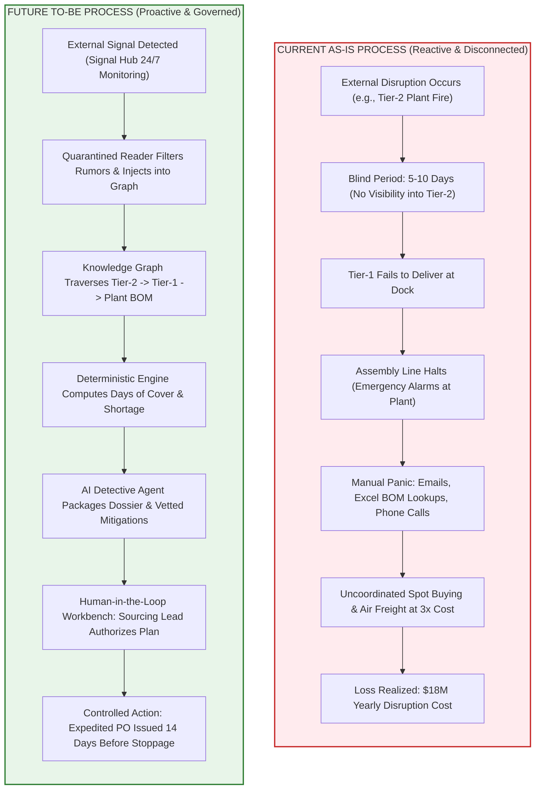

# BUSINESS REQUIREMENTS DOCUMENT (BRD)
## ApexMotion Supplier Risk Intelligence Platform
**Document Version:** 1.0  
**Status:** Approved for Implementation  
**Project Sponsor:** Chief Procurement Officer & VP of Global Supply Chain, ApexMotion  
**Delivery Partner:** EURON Consulting / Forward Deployment Engineering (FDE)  
**Standard Compliance:** AI Solution Architecture Masterclass (BRD Standard - Slide 6)

---

## 1. Executive Summary

### 1.1 Context & Background
ApexMotion is a multinational Tier-1 automotive technology manufacturer specializing in electric vehicle (EV) high-voltage battery packs, powertrain electronics, and smart control units. The company operates high-throughput manufacturing plants across **India (Bengaluru, Pune)**, **Germany (Munich)**, **Mexico**, **Vietnam**, and the **United States**. ApexMotion manages an intricate global supply network comprising **4,500 active suppliers across 38 countries** managing over **65,000 active component SKUs**.

In the prior fiscal year, ApexMotion suffered **USD 18,000,000** in direct operational and financial losses due to late detection of supplier-side disruptions, production line halts, and uncoordinated emergency spot procurement. While ApexMotion maintains direct transactional visibility over its Tier-1 suppliers, its multi-tier supply chain (Tier-2 sub-tier component manufacturers and Tier-3 raw material processors) operates in complete obscurity. Critical bottlenecks—such as fires at unrecorded Tier-2 semiconductor fabricators, sudden Tier-2 supplier insolvencies, or unchecked component quality degradation—are typically identified only after component inventory on the plant floor has been exhausted.

### 1.2 Program Vision
The **ApexMotion Supplier Risk Intelligence Platform** is an enterprise-grade, proactive risk management and decision-support system. It transforms ApexMotion’s supply chain posture from reactive fire-fighting to continuous, predictive risk mitigation. By combining 24/7 global external signal monitoring with internal operational enterprise systems, the platform delivers an early warning horizon of **7 to 30 days**, giving sourcing managers, plant directors, and procurement leaders sufficient lead time to mitigate disruptions before factory lines stall.

```
       ┌────────────────────────────────────────────────────────┐
       │     THE TRIAD ARCHITECTURAL SEPARATION OF RESPONSIBILITY│
       └────────────────────────────────────────────────────────┘
                 │                         │                     │
                 ▼                         ▼                     ▼
      ┌──────────────────────┐  ┌─────────────────────┐  ┌──────────────────┐
      │   ARTIFICIAL INTEL.  │  │DETERMINISTIC ENGINES│  │ HUMAN AUTHORITY  │
      │        (AI)          │  │     (SOFTWARE)      │  │     (HITL)       │
      ├──────────────────────┤  ├─────────────────────┤  ├──────────────────┤
      │• Ingests signals     │  │• Inventory coverage │  │• Reviews dossiers│
      │• Reads PDF contracts │  │• Daily burn rate    │  │• Authorizes cash │
      │• Synthesizes dossier │  │• Shortage gap math  │  │• Signs vendor PO │
      │• Suggests options    │  │• Dollar exposure    │  │• Approves swaps  │
      │• ZERO Math Auths     │  │• Strict, 100% Exact │  │• Final Decision  │
      └──────────────────────┘  └─────────────────────┘  └──────────────────┘
```

### 1.3 The Core Architectural Principle: The Triad of Responsibility
A non-negotiable architectural tenet mandated for this platform is the **Strict Separation of Responsibilities**:
1. **AI / Large Language Models (Evidence & Synthesis):** Responsible for parsing unstructured natural language (news feeds, disaster bulletins, unstructured PDF contracts, supplier email communications), performing entity extraction, discovering potential correlations, and synthesizing human-readable risk dossiers. **LLMs are strictly forbidden from performing mathematical calculations, inventory estimations, or autonomous decision-making.**
2. **Deterministic Services (Exact Calculation):** Responsible for 100% reproducible, verifiable business logic and arithmetic computations—including exact days of inventory coverage, daily burn rates, component shortage volumes, and dollar financial exposure.
3. **Human Decision-Makers (Consequential Authorization):** High-stakes actions—such as approving emergency air freight, activating alternative suppliers, adjusting plant production schedules, or committing financial capital—**strictly require Human-in-the-Loop (HITL) authorization** via cryptographically verifiable approval tokens.

### 1.4 Business Impact & ROI
* **Disruption Reduction:** 25% to 40% reduction in supply-chain-induced production line stoppages.
* **Annual Net Savings:** **USD 4,500,000 to USD 7,200,000** annually in avoided factory downtime, expedited freight penalties, and OEM service-level agreement (SLA) breach fines.
* **Payback Horizon:** Full capital investment recovered within **3 months** of global production deployment.

---

## 2. Business Problem and Objectives

### 2.1 The Core Business Problem
ApexMotion’s current supply chain operating model suffers from four structural vulnerabilities:

1. **The Multi-Tier Supplier Blind Spot:** ApexMotion maintains formal purchase orders and transactional relationships with Tier-1 system assemblers (e.g., battery enclosure manufacturers, wire harness suppliers). However, it possesses zero systematic visibility into Tier-2 micro-component makers (e.g., specialized microcontrollers, passive components) or Tier-3 raw material refiners (e.g., battery-grade lithium, cobalt). When a sub-tier supplier fails, ApexMotion is blind to the impact until Tier-1 shipments fail to arrive at the plant dock.
2. **Fragmented Enterprise Data Silos:** Critical supply chain information is trapped across disconnected applications:
   * Sourcing and inventory data lives in **SAP ERP**.
   * Purchase orders and supplier agreements sit in **Coupa Procurement**.
   * Engineering Bills of Materials (eBOMs) and Manufacturer Part Numbers (MPNs) are housed in **Siemens Teamcenter PLM**.
   * Incoming component quality test logs reside in disconnected plant **Manufacturing Execution Systems (MES)**.
   * Master vendor contracts and force majeure commitments are buried as scanned PDFs in SharePoint folders.
3. **Information Lag and Alert Fatigue:** Global supply disruptions (such as port congestion, extreme weather, geopolitical trade embargoes, or supplier insolvency) are detected via manual web searches or informal supplier notifications 12 to 48 hours *after* the event occurs. Conversely, automated keyword scrapers overwhelm supply chain teams with thousands of irrelevant news alerts, creating severe alert fatigue.
4. **Historical Catastrophic Disruption Precedents:**
   * *The NanoCore Incident:* A localized cleanroom fire at NanoCore Semiconductor (a Tier-2 supplier of microcontroller MCU-X91 in Taiwan) went completely unnoticed by ApexMotion for 6 days because NanoCore had no direct ERP vendor profile. By the time Tier-1 module suppliers notified ApexMotion, plant inventory buffers had run dry, forcing a **12-day assembly line shutdown** at the Munich and Bengaluru plants.
   * *Unchecked Quality Drift:* A passive electronic component vendor experienced a manufacturing defect rate spike from 0.7% to 4.0%. Because quality logs were trapped in local plant databases, over 3,000 assembled EV battery management units were contaminated before cross-plant correlations were discovered.

### 2.2 Strategic Business Objectives
| ID | Strategic Objective | Target Business State | Baseline (Current State) |
| :--- | :--- | :--- | :--- |
| **SBO-01** | **Predictive Risk Horizon** | Detect upstream supplier risks **7 to 30 days** before physical stockouts impact manufacturing. | **0 days** (Reactive discovery after shipment failure or line stoppage). |
| **SBO-02** | **Multi-Tier Network Transparency** | Map complete dependency paths from Tier-1 through Tier-3 across **4,500 suppliers** and **65,000 SKUs**. | **Tier-1 visibility only**; Tier-2 and Tier-3 relationships are completely unmapped. |
| **SBO-03** | **Rapid Incident Investigation** | Synthesize verified external signals, map component exposure, and calculate stock impact in **under 90 seconds**. | **48 to 72 hours** of manual emails, spreadsheets, and cross-department calls. |
| **SBO-04** | **Deterministic Financial Impact** | Quantify plant-level financial exposure in exact dollar figures (idle labor costs, margin loss, OEM SLA penalties). | Subjective guesswork without clear dollar quantification. |
| **SBO-05** | **Prescriptive Mitigation Scenarios** | Automatically present sourcing leaders with vetted, ranked mitigation options (dual-source activation, freight rerouting). | Manual, uncoordinated panic sourcing and expensive spot buying. |
| **SBO-06** | **Enterprise Governance & Auditability** | Provide 100% cryptographic auditability for all AI syntheses, mathematical computations, and human sign-offs. | Ad-hoc email approvals with zero institutional memory or audit trails. |

---

## 3. Scope and Out of Scope

```
┌────────────────────────────────────────────────────────────────────────┐
│                        PROJECT BOUNDARIES MATRIX                       │
├───────────────────────────────────┬────────────────────────────────────┤
│           IN-SCOPE                │            OUT-OF-SCOPE            │
├───────────────────────────────────┼────────────────────────────────────┤
│ • Ingestion of SAP ERP, Coupa,    │ • Direct autonomous purchasing,    │
│   PLM Teamcenter, & MES data      │   wire transfers, or PO approvals  │
│ • External feeds (news, weather,  │ • Replacement of existing ERP,     │
│   AIS marine traffic, credit risk)│   PLM, MES, or procurement systems │
│ • Dynamic Multi-Tier Knowledge    │ • Physical automation of factory   │
│   Graph (Tier-1, Tier-2, Tier-3)  │   assembly lines, PLCs, or robots  │
│ • Deterministic inventory cover,  │ • Consumer-facing EV automotive    │
│   shortage, & dollar impact math  │   applications or infotainment     │
│ • AI-assisted contract & clause   │ • B2C aftermarket retail part      │
│   extraction (force majeure, SLA) │   distribution or dealer inventory │
│ • Human-in-the-Loop triage &      │ • Custom LLM pre-training from     │
│   prescriptive scenario workbench │   scratch (uses fine-tuning/RAG)   │
└───────────────────────────────────┴────────────────────────────────────┘
```

### 3.1 In-Scope Capabilities
1. **Multi-Source Enterprise Ingestion:** Automated data connectors for SAP ERP (inventory on hand, open POs), Coupa (contracts, vendor profiles), Siemens Teamcenter (BOMs, MPNs), and plant-level MES quality records.
2. **Global External Intelligence Ingestion:** Real-time ingestion and sanitization of unstructured data streams: commercial maritime vessel tracking (AIS), port congestion data, regional weather/natural disaster feeds, credit rating changes, geopolitical sanction updates, and global news feeds.
3. **Multi-Tier Knowledge Graph Construction:** Graph modeling of nodes (Suppliers, Sub-contractors, Parts, Finished Goods, Plants, Customer Vehicle Programs) and directional relationships (`SUPPLIES`, `CONTAINS`, `ASSEMBLED_AT`, `DELIVERED_TO`).
4. **Intelligent Noise Filtering & Quarantined Ingestion:** Architectural isolation of untrusted external news to prevent prompt injection and false rumor propagation.
5. **Deterministic Calculation Engines:** Production-grade services calculating exact Days of Cover, daily consumption burn rates, projected stockout dates, and plant-level financial damage.
6. **AI Detective Agent & Case Workbench:** Orchestrated investigation workflow that compiles verified evidence, cross-checks supplier contracts for secondary sources, and packages actionable dossiers for human review.
7. **Human-in-the-Loop Governance:** Role-based delegation, two-person rule for capital commitments over USD 100,000, and immutable audit logging.
8. **Phased Plant Rollout:** Initial deployment across Bengaluru, Pune, and Munich, followed by Mexico, Vietnam, and the US.

### 3.2 Out-of-Scope (Strict Exclusions)
1. **Autonomous Financial Execution:** The system shall **never** autonomously issue binding purchase orders, wire payments, modify supplier contracts, or terminate agreements without human authorization.
2. **Core Transactional System Replacement:** The platform is an intelligence and orchestration layer; it will **not** replace SAP ERP, Coupa, Teamcenter, or MES.
3. **Physical Shop-Floor Control:** The system will not directly communicate with programmable logic controllers (PLCs), factory robotics, or physical warehouse automated guided vehicles (AGVs).
4. **Consumer B2C Operations:** Dealership inventory management and end-user vehicle telematics are excluded.

---

## 4. Stakeholder Analysis and Personas

| Stakeholder Persona | Organizational Role | Core Objectives & Value Proposition | System Interaction / Responsibilities |
| :--- | :--- | :--- | :--- |
| **Chief Procurement Officer (CPO)** | Executive Sponsor | Reduce supply disruption risk, prevent multi-million-dollar losses, maintain OEM trust, and ensure corporate ESG/regulatory compliance. | Reviews executive risk dashboards, monitors program ROI, and approves strategic sourcing policy exceptions. |
| **VP of Global Supply Chain & Logistics** | Operational Sponsor | Ensure continuous manufacturing continuity across all 5 countries; optimize safety stock holding costs; resolve shipping bottlenecks. | Evaluates global supply health; authorizes inter-plant inventory transfers and premium freight budgets. |
| **Strategic Sourcing & Category Managers** | Business User | Monitor supplier health in assigned categories (semiconductors, lithium cells, structural metal); enforce supplier SLAs. | Reviews AI-extracted contract clauses; evaluates alternate qualified vendors; negotiates emergency capacity. |
| **Plant Materials & Operations Managers** *(Bengaluru, Pune, Munich)* | Operational User | Prevent factory assembly line shutdowns; protect daily production targets; manage plant safety buffers. | Receives plant-specific shortage alerts; approves production schedule rebalancing or model line prioritization. |
| **Supply Chain Risk Analysts** | Primary System Operator | Triage daily signals; run incident investigations; corroborate evidence; prepare mitigation packages for leadership. | Operates the Detective Agent workbench; validates risk alerts; compiles actionable mitigation packages. |
| **Legal & Commercial Compliance Counsel** | Governance Stakeholder | Ensure supplier contract adherence; assess force majeure declarations; ensure compliance with sanctions and trade laws. | Inspects WORM audit logs; reviews contractual liability and penalty clauses before supplier dispute actions. |
| **CISO & Enterprise IT Architecture** | Technical Stakeholder | Ensure zero data leakage of proprietary EV designs and contract pricing; defend against prompt injection; guarantee 99.9% SLA. | Validates security isolation (VPC, Quarantined Reader, Langfuse tracing, AWS KMS encryption). |

---

## 5. Current Process vs. Future Process (As-Is vs. To-Be)



### 5.1 Capability-by-Capability Process Transformation

| Business Capability | Current As-Is Process | Future To-Be Process (Platform) | Business Benefit |
| :--- | :--- | :--- | :--- |
| **1. SENSE** *(Signal Monitoring)* | Sourcing teams manually browse news or wait for panicked supplier emails after a factory shutdown. | Continuous, automated ingestion of global multi-modal feeds (news, AIS vessel locations, weather, ERP transactions) via an event-driven architecture. | **7 to 30 days** advance notice; elimination of blind spots. |
| **2. UNDERSTAND** *(Dependency Mapping)* | Relationships exist solely as 1-to-1 supplier records in SAP. Tier-2 and Tier-3 sub-tier linkages are unrecorded. | Dynamic Multi-Tier Knowledge Graph mapping suppliers, sub-tiers, MPNs, assemblies, plants, and OEM vehicle programs. | Instant trace of multi-tier supply chain paths from raw wafer to customer EV. |
| **3. ASSESS** *(Impact Calculation)* | Analysts spend 2 to 3 days manually combining spreadsheets, often miscalculating burn rates under stress. | Deterministic Calculation Engine computes exact Days of Cover, daily burn rates, stockout dates, and line shutdown financial loss in seconds. | 100% mathematical accuracy; zero hallucination; instant financial exposure quantification. |
| **4. DECIDE** *(Mitigation Modeling)* | Chaotic emergency meetings; sourcing managers call known contacts without knowing contract terms or secondary source qualifications. | AI Detective Agent cross-references approved vendor lists (AML) and contract clauses to propose ranked, costed mitigation strategies. | Decision cycle compressed from **72 hours to under 90 seconds**. |
| **5. ACT** *(Execution Governance)* | Uncoordinated actions via informal emails; unapproved spending; high risk of procurement fraud or duplicate spot orders. | Centralized Case Management with cryptographic Human-in-the-Loop approval tokens and automated draft order generation. | Controlled, auditable action execution; zero rogue spending. |
| **6. LEARN & GOVERN** *(Audit & Compliance)* | No record of past decisions or resolution outcomes; the same supply disruptions recur annually without institutional learning. | Tamper-evident, WORM-compliant audit ledger capturing incoming signals, raw prompts, calculation logs, and human decisions. | 100% audit compliance for automotive ISO/TS standards; continuous model improvement. |

---

## 6. Business Requirements (Capabilities & Rules)

The functional and operational requirements of the platform are organized around the six foundational pillars of the **ApexMotion Business Capability Map**:

### 6.1 Pillar 1: SENSE (Signal Ingestion & Monitoring)
* **BR-SEN-01: Multi-Modal Feed Ingestion:** The platform must ingest structured operational events (ERP inventory balance changes, purchase order status updates, goods receipts, ASN shipment notices) and unstructured external events (global news, weather hazards, geopolitical sanctions, port congestion) continuously.
* **BR-SEN-02: Operational Signal Ingestion Throughput:** The system must comfortably ingest an average volume of **1,110,000 events/day (~12.8 events/sec)**, with the capacity to absorb burst rates of up to **1,285 events/sec** during global crisis incidents without data loss.
* **BR-SEN-03: Noise Cancellation & Signal Validation:** The system must implement multi-source corroboration algorithms to distinguish verified industrial disruptions from unconfirmed market rumors before generating high-priority analyst alerts.
* **BR-SEN-04: Quarantined Reader Pattern:** External, untrusted textual signals (such as public web articles or supplier emails) must be processed through an isolated sanitization layer to strip prompt injection attempts and malicious formatting before ingestion into downstream agent workflows.

### 6.2 Pillar 2: UNDERSTAND (Dependency & Document Intelligence)
* **BR-UND-01: Entity Resolution & Data Normalization:** The platform must reconcile inconsistent supplier identities, naming variations (e.g., "NanoCore Corp", "NanoCore Taiwan Ltd", "NC Semiconductor"), and conflicting part numbers across SAP, Coupa, and Teamcenter into unified Master Entity IDs.
* **BR-UND-02: Multi-Tier Knowledge Graph Modeling:** The system must maintain an active graph representation containing at least **400,000 nodes and 3,000,000 edges**, linking:
  * Tier-1, Tier-2, and Tier-3 Supplier Entities
  * Manufacturer Part Numbers (MPNs) and Internal SKUs (65,000 active components)
  * Engineering Bill of Materials (eBOMs) and Sub-Assemblies
  * Manufacturing Facilities (Bengaluru, Pune, Munich, Mexico, Vietnam, US)
  * OEM Vehicle Programs and Finished EV Powertrains
* **BR-UND-03: Unstructured Contract Intelligence:** The platform must ingest and index over **60,000 supplier contracts (~1.2 million pages)**. It must accurately extract key commercial terms, including:
  * Minimum Lead Time and Expedited Delivery SLAs
  * Force Majeure clauses and liability caps
  * Dual-sourcing and secondary supplier pre-authorizations
  * Unit cost structures and penalty terms for late delivery

### 6.3 Pillar 3: ASSESS (Exposure & Mathematical Impact Engine)
* **BR-ASS-01: Multi-Tier Exposure Tracing:** Upon receiving a confirmed disruption event for any supplier (at any tier), the system must traverse the knowledge graph to identify all affected downstream components, manufacturing lines, and finished vehicle programs within **5 seconds**.
* **BR-ASS-02: Deterministic Inventory Cover Calculation:** Days of inventory coverage must be calculated strictly using deterministic software services based on live ERP stock balances and production burn rates. The calculation must adhere to:
  $$\text{Days of Cover} = \frac{\text{Usable Stock on Hand}}{\text{Average Daily Consumption Rate}}$$
* **BR-ASS-03: Shortage Gap & Volume Estimation:** The system must compute the exact supply deficit by evaluating incoming purchase orders against verified carrier transit schedules:
  $$\text{Shortage Gap (Days)} = \text{Confirmed Inbound Arrival ETA (Days)} - \text{Days of Cover}$$
  $$\text{Projected Shortage (Units)} = \text{Shortage Gap (Days)} \times \text{Average Daily Consumption Rate}$$
  *(Note: If Inbound Arrival ETA $\le$ Days of Cover, Shortage Gap is zero).*
* **BR-ASS-04: Deterministic Financial Exposure Quantification:** The platform must calculate the total monetary loss per day of factory stoppage, incorporating:
  * Idle Direct Manufacturing Labor Costs
  * Lost Finished Unit Gross Contribution Margins
  * OEM Customer Contractual Breach Penalties
  * Expedited Logistics Premiums

```
┌────────────────────────────────────────────────────────────────────────┐
│             CASE SCENARIO: NANOCORE INCIDENT (SR-2026-091)             │
├────────────────────────────────────────────────────────────────────────┤
│ • External Event: Factory cleanroom fire at NanoCore Semiconductor.     │
│ • Component Impacted: MCU-X91 Microcontroller (Tier-2 Component).       │
│ • Assembly Dependency: Tier-1 Battery ECU & Motor Controller Units.    │
│ • Plants Impacted: Munich, Bengaluru, and Pune manufacturing lines.     │
│ • Usable Stock on Hand: 142,000 units.                                 │
│ • Average Daily Consumption: 18,500 units/day across plants.           │
│ • Deterministic Days of Cover: 142,000 / 18,500 = 7.7 Days.           │
│ • Inbound Shipment ETA: 80,000 units arriving in 9.0 Days.             │
│ • Production Gap: 9.0 - 7.7 = 1.3 Days of total stockout.             │
│ • Projected Component Shortage: 1.3 x 18,500 = 24,050 (~24,500) units. │
│ • Financial Risk: $2.4M line downtime penalty + OEM delivery default.  │
│ • System Action: Vetted mitigation plan generated in 82 seconds.        │
└────────────────────────────────────────────────────────────────────────┘
```

### 6.4 Pillar 4: DECIDE (Agentic Investigation & Scenario Modeling)
* **BR-DEC-01: End-to-End Investigation Latency:** The system’s automated Detective Agent must complete an end-to-end incident investigation—from signal verification through graph traversal, mathematical calculation, and mitigation packaging—in **under 90 seconds**.
* **BR-DEC-02: Prescriptive Mitigation Modeling:** For every verified shortage, the system must formulate and rank at least three distinct, actionable mitigation scenarios:
  * *Option A (Logistics Acceleration):* Expediting confirmed inbound maritime purchase orders to air charter freight, reducing transit lead times.
  * *Option B (Secondary Source Activation):* Activating an approved secondary supplier from the Approved Manufacturer List (AML) using pre-negotiated contract clauses.
  * *Option C (Production Rebalancing):* Shifting manufacturing allocation from low-margin vehicle programs to high-margin or critical OEM customer commitments.
* **BR-DEC-03: Scenario Cost-Benefit Scoring:** Each mitigation scenario must include an automated cost-benefit evaluation comparing the cost of execution (e.g., spot air freight fees) against the cost of inaction (assembly line downtime penalties).

### 6.5 Pillar 5: ACT (Human-in-the-Loop Execution & Case Management)
* **BR-ACT-01: Mandatory Human Approval (HITL):** Under no circumstances shall the platform autonomously execute binding commercial transactions. All mitigation options must be packaged into a structured Case Dossier requiring explicit human approval.
* **BR-ACT-02: Cryptographic Approval Tokens:** The platform must issue unique, time-bound, cryptographically signed approval tokens for every authorized action. An action cannot proceed without a valid token signed by an authenticated user with appropriate role permissions.
* **BR-ACT-03: Multi-Level Financial Authorization:**
  * Spend commitments $\le$ USD 25,000: Category Sourcing Manager approval.
  * Spend commitments USD 25,001 to USD 100,000: Global Procurement Director approval.
  * Spend commitments $>$ USD 100,000: Dual authorization (VP of Supply Chain + Chief Financial Officer).
* **BR-ACT-04: Controlled Action Drafting:** Upon receiving human approval, the system must generate structured draft artifacts (e.g., draft SAP Purchase Requisition amendments, carrier logistics rerouting instructions, supplier formal notices) and transmit them to target enterprise systems via secure APIs.

### 6.6 Pillar 6: LEARN & GOVERN (Auditability, Security & Evals)
* **BR-GOV-01: Tamper-Evident WORM Audit Ledger:** Every stage of an investigation—including original external news snippets, LLM reasoning chains, graph queries, exact deterministic calculation outputs, and human sign-off timestamps—must be permanently archived in Write-Once-Read-Many (WORM) storage with an indefinite retention policy.
* **BR-GOV-02: Hallucination Prevention & Source Grounding:** Every statement in an AI-generated risk summary must link directly to verifiable source artifacts (e.g., specific contract page and paragraph, ERP purchase order number, official carrier bill of lading). Unsupported assertions are strictly prohibited.
* **BR-GOV-03: Enterprise Data Privacy & Isolation:** All proprietary component designs, pricing schedules, supplier master agreements, and volume forecasts must remain within ApexMotion’s dedicated cloud Virtual Private Cloud (VPC). No proprietary corporate data may be used to train public commercial foundational models.
* **BR-GOV-04: Continuous Evaluation (Evals in CI):** The system must maintain a regression suite of "Golden Datasets" representing past historical incidents (including the NanoCore semiconductor fire). Any update to system prompts, agent workflows, or models must pass an automated evaluation threshold before deployment:
  * Entity extraction precision $\ge 98\%$
  * Dependency graph retrieval recall $\ge 99.5\%$
  * Mathematical consistency $= 100\%$

---

## 7. Assumptions, Constraints, and Dependencies

```
┌────────────────────────────────────────────────────────────────────────┐
│                      PROJECT GOVERNANCE BOUNDARIES                     │
├────────────────────────────────────────────────────────────────────────┤
│ ASSUMPTIONS                                                            │
│ • Minimum 12-24 months of clean historical ERP & PO data available.    │
│ • Tier-1 contracts available in digitized PDF format for ingestion.    │
│ • Client IT provides dedicated network bridges and REST/OData APIs.    │
├────────────────────────────────────────────────────────────────────────┤
│ CONSTRAINTS                                                            │
│ • System Availability target: 99.9% uptime (<= 8.8 hrs downtime/year). │
│ • End-to-end investigation latency must not exceed 90 seconds.         │
│ • Mandatory Human-in-the-Loop: Zero autonomous financial commitments.  │
│ • Complete VPC isolation for sensitive commercial & design data.       │
│ • Multi-jurisdictional compliance: EU GDPR, India DPDP, US CCPA.      │
├────────────────────────────────────────────────────────────────────────┤
│ DEPENDENCIES                                                           │
│ • Uninterrupted API connectivity to SAP ERP, Coupa, & Teamcenter PLM.  │
│ • Third-party external subscriptions: AIS marine data, global news.    │
│ • Enterprise Identity Provider (Okta/Azure AD) with SAML 2.0 / MFA.    │
└────────────────────────────────────────────────────────────────────────┘
```

### 7.1 Assumptions
1. **Historical Data Completeness:** ApexMotion will provide at least 12 to 24 months of historical purchase order records, goods receipt logs, invoice registers, and supplier quality incident reports to establish baseline behavioral patterns.
2. **Contract Availability:** Sourcing teams have access to active supplier contracts in searchable PDF or high-resolution scanned format suitable for OCR parsing.
3. **IT Collaboration:** ApexMotion IT will allocate dedicated engineering resources to provision API integration endpoints and firewall clearances within the first 4 weeks of project kickoff.

### 7.2 System Constraints
1. **High Availability (99.9% SLO):** The platform must maintain **99.9% production availability**, permitting no more than 8.76 hours of unscheduled downtime across a calendar year.
2. **Graceful Degradation:** In the event that the external LLM provider or self-hosted GPU inference cluster experiences an outage or severe latency spike, the platform must **gracefully degrade**:
   * Deterministic calculation engines, ERP inventory sync, and rule-based threshold alerts must remain 100% operational.
   * Sourcing managers must still be able to query raw stock cover and supply gaps via deterministic fallback dashboards.
3. **Investigation Latency:** The end-to-end processing pipeline for a risk event must complete within **90 seconds** at p95 latency.
4. **Data Residency & Compliance:** Supplier data originating in Germany must comply with European Union General Data Protection Regulation (GDPR) and EU Supply Chain Due Diligence Act (LkSG) standards. Indian plant records must comply with the Digital Personal Data Protection (DPDP) Act.

### 7.3 Dependencies
1. **Core Enterprise Integrations:** Timely provisioning of read/write access to SAP S/4HANA (via OData/RFC), Coupa Procurement APIs, and Siemens Teamcenter PLM APIs.
2. **External Data Provider Subscriptions:** Active enterprise licenses for commercial news syndication feeds, maritime vessel tracking (AIS), port congestion telemetry, and weather alerts.
3. **Enterprise Identity Integration:** Integration with ApexMotion's corporate Okta / Azure Active Directory single sign-on (SSO) infrastructure supporting Role-Based Access Control (RBAC) and Multi-Factor Authentication (MFA).

---

## 8. Success Metrics (KPIs) and Target Business Outcomes

To ensure objective accountability, project success will be measured against specific, quantifiable business, operational, and governance metrics:

```
┌────────────────────────────────────────────────────────────────────────┐
│                        KEY PERFORMANCE INDICATORS                      │
├────────────────────────────────────────────────────────────────────────┤
│ BUSINESS OUTCOMES                                                      │
│ • Annual Disruption Cost Reduction: 25% to 40% ($4.5M to $7.2M/yr)     │
│ • Early Risk Detection Lead Time: 7 to 30 Days (from 0 days reactive)  │
│ • Safety Stock Holding Cost Reduction: 10% to 15% across plants        │
├────────────────────────────────────────────────────────────────────────┤
│ OPERATIONAL EFFICIENCY                                                 │
│ • End-to-End Investigation Latency: < 90 Seconds (from 48-72 hours)    │
│ • Signal Noise Cancellation Accuracy: >= 95% Precision                │
│ • Mitigation Recommendation Acceptance Rate: >= 75%                    │
├────────────────────────────────────────────────────────────────────────┤
│ GOVERNANCE & ADOPTION                                                  │
│ • Active Sourcing User Adoption Rate: >= 85% within 60 days of launch  │
│ • Cryptographic Audit Ledger Coverage: 100% of all decisions logged    │
│ • Mathematical Calculation Error Rate: 0.00% (Strictly Deterministic)  │
└────────────────────────────────────────────────────────────────────────┘
```

### 8.1 Metric Breakdown & Target Measurement
| Metric Category | Key Performance Indicator (KPI) | Baseline (Current State) | Target (Future State) | Measurement Method & Cadence |
| :--- | :--- | :--- | :--- | :--- |
| **Financial** | **Annual Supply Chain Loss** | USD 18,000,000 / year | $\le$ USD 11,500,000 / year (**$4.5M–$7.2M savings**) | Audited quarterly financial reports of downtime losses and freight surcharges. |
| **Financial** | **Safety Stock Holding Costs** | USD 42,000,000 working capital | 10% to 15% reduction in buffer stock requirements | Monthly SAP working capital inventory audits. |
| **Operational** | **Risk Detection Horizon** | 0 days (discovered at dock arrival or line failure) | **7 to 30 days advance warning** | Time delta between platform risk alert creation and physical stock depletion date. |
| **Operational** | **Incident Investigation Speed** | 48 to 72 hours of manual investigation | **$\le$ 90 seconds** per complete case dossier | Automated system latency telemetry from signal ingestion to dossier publication. |
| **Operational** | **Signal Filtering Precision** | < 10% (analysts overwhelmed by noise) | **$\ge$ 95% precision** on published high-severity alerts | Ratio of validated, actionable disruptions to total external raw signals ingested. |
| **Adoption** | **Sourcing Team Active Usage** | 0% (Platform does not exist) | **$\ge$ 85% weekly active usage** across all 5 plants | Okta / system login logs and active case reviews within 60 days of plant go-live. |
| **Decision** | **Recommendation Acceptance** | N/A (Manual sourcing) | **$\ge$ 75%** of approved actions adopt platform mitigation options | Platform analytics tracking user approval of Option A, B, or C versus manual overrides. |
| **Governance** | **Audit Trail Integrity** | Disconnected emails and chats | **100% tamper-evident audit logging** | Quarterly independent compliance audits verifying WORM storage cryptographic hashes. |

---

## 9. Costs, Benefits, and Risks

### 9.1 Total Cost of Ownership (TCO) Framework
System cost planning incorporates implementation delivery phases and ongoing monthly production operating costs:

```
┌────────────────────────────────────────────────────────────────────────┐
│                   TOTAL COST OF OWNERSHIP (ESTIMATED)                  │
├─────────────────────────────────────────┬──────────────────────────────┤
│ COMPONENT / PHASE                       │ ESTIMATED INVESTMENT         │
├─────────────────────────────────────────┼──────────────────────────────┤
│ Phase 1: Proof of Concept (Weeks 1–10)  │ USD 280,000 (Fixed Delivery) │
│ Phase 2: MVP Pilot Launch (Weeks 11–22) │ USD 450,000 (Fixed Delivery) │
│ Phase 3: Global Production (Weeks 23–30)│ USD 320,000 (Fixed Delivery) │
├─────────────────────────────────────────┼──────────────────────────────┤
│ TOTAL ONE-TIME IMPLEMENTATION SERVICES  │ USD 1,050,000                │
├─────────────────────────────────────────┼──────────────────────────────┤
│ Monthly Operating Infrastructure & AI   │ USD 15,150 – USD 25,250 / mo │
│ Annual Recurring Infrastructure / Cloud │ USD 181,800 – USD 303,000 / yr│
└─────────────────────────────────────────┴──────────────────────────────┘
```

#### Detailed Monthly Production Run Cost Breakdown
Based on **4,500 active suppliers**, **1.11 million daily events**, **60,000 contracts (~3M chunks)**, and **40 to 80 daily agent investigations (~21.5M tokens/day)**:
* **Event Streaming & Compute:** Amazon MSK (3 brokers across 3 AZs) + AWS EKS Compute Cluster: ~USD 4,200 / month.
* **Database & Graph Infrastructure:** Amazon Neptune (2 $\times$ db.r6g.2xlarge) + Aurora PostgreSQL Serverless: ~USD 4,800 / month.
* **Vector Search & Storage:** Amazon OpenSearch Service (~3 million chunks indexed with k-NN): ~USD 2,400 / month.
* **Managed LLM Inference (Amazon Bedrock / Claude 3.5 Sonnet / Haiku):** Dynamic routing consuming ~21.5M tokens/day: ~USD 3,750 – USD 8,500 / month.
* **Logging, Tracing & Audit Archive:** OpenTelemetry + Langfuse + S3 Object Lock: ~USD 1,200 / month.
* *Benchmark Metric:* **USD 3.37 to USD 5.61 operating cost per active supplier per month.**

### 9.2 Comprehensive Business Value & ROI
* **Annual Loss Prevention:** Baseline annual loss of USD 18,000,000 reduced by 25%–40% yields direct gross annual savings of **USD 4,500,000 to USD 7,200,000**.
* **Net Year 1 Financial Benefit:**
  $$\text{Gross Savings (Conservative 25%)} = \text{USD 4,500,000}$$
  $$\text{Total Year 1 Cost (Capex + Opex)} = \text{USD 1,050,000} + \text{USD 250,000} = \text{USD 1,300,000}$$
  $$\text{Net Year 1 Cash Return} = \text{USD 3,200,000}$$
* **Payback Period:**
  $$\text{Payback Horizon} = \frac{\text{USD 1,300,000}}{\text{USD 375,000 monthly gross savings}} \approx \mathbf{3.4\text{ months}}.$$

### 9.3 Business Risk Matrix & Mitigation Strategies

| Risk ID | Risk Description & Impact | Severity / Likelihood | Strategic Mitigation Approach |
| :--- | :--- | :--- | :--- |
| **RSK-01** | **Master Data Inaccuracy & Graph Incompleteness:** Corrupt ERP master records or unmapped Tier-2 connections lead to false negatives. | **High / High** | Implement automated Data Stewardship Workflows. Deploy confidence scoring on all graph edges; automatically flag incomplete BOM paths for manual sourcing enrichment. |
| **RSK-02** | **AI Hallucinations & Math Errors:** Language model generates incorrect stock coverage numbers or invents false inventory balances. | **Critical / Low** | **The Triad Architecture Rule:** LLMs are strictly isolated from arithmetic. All coverage, burn rate, and shortage math is executed by deterministic Python services. |
| **RSK-03** | **Analyst Alert Fatigue & False Positives:** Excessive alerts generated by unverified news rumors cause users to ignore notifications. | **High / Medium** | Implement the Quarantined Reader and strict multi-source corroboration rules. High-priority alarms are suppressed until confirmed by at least two independent telemetry streams. |
| **RSK-04** | **Prompt Injection via External Feeds:** Adversarial web content or supplier emails attempt to hijack LLM instructions. | **Critical / Low** | Dedicated Quarantined Reader pattern: external text is treated strictly as untrusted unstructured payload data; input tokens are stripped of command syntax before model analysis. |
| **RSK-05** | **User Distrust & Adoption Resistance:** Category managers bypass the platform and revert to manual, uncoordinated spreadsheets. | **Medium / Medium** | Mandate full explainability: every AI dossier displays clickable citation links directly to ERP purchase orders and contract clauses. Include sourcing managers in Phase 1 POC testing. |

---

## 10. Phased Delivery Roadmap & Acceptance Criteria

```mermaid
gantt
    title ApexMotion Supplier Risk Intelligence Platform - Delivery Roadmap
    dateFormat  WW
    axisFormat  W%W
    
    section Phase 1: POC
    Simulation Framework Setup       :a1, 01, 4w
    NanoCore Scenario Simulation     :a2, after a1, 3w
    Gate Review & Validation         :a3, after a2, 3w

    section Phase 2: MVP Pilot
    Connectors (SAP, Coupa, BOM)    :b1, after a3, 4w
    Bengaluru, Pune, Munich Go-Live  :b2, after b1, 6w
    Dual-Run Acceptance Review       :b3, after b2, 2w

    section Phase 3: Global Production
    Mexico, Vietnam, US Rollout      :c1, after b3, 4w
    Full Production Cutover          :c2, after c1, 3w
    Hypercare & Handover             :c3, after c2, 1w
```



### 10.1 Delivery Phases & Timeline
* **Phase 1: Proof of Concept (POC) — Weeks 1 to 10**
  * *Scope:* Synthetic environment deployment; ingestion of sample ERP data and 5,000 supplier contracts.
  * *Milestone:* Execute the **NanoCore Cleanroom Fire Incident Simulation (SR-2026-091)**. Prove end-to-end traversal from unlisted Tier-2 supplier through MCU-X91 to Battery ECU BOMs, deterministic shortage calculation, and sub-90-second dossier generation.
  * *Exit Gate:* CPO and VP of Supply Chain sign-off on simulation accuracy and architecture governance.
* **Phase 2: MVP Pilot Deployment — Weeks 11 to 22**
  * *Scope:* Live enterprise connectivity with SAP S/4HANA, Coupa, and Teamcenter. Rollout to three pilot manufacturing hubs: **Bengaluru (India), Pune (India), and Munich (Germany)**.
  * *Milestone:* Live 24/7 signal monitoring; triage of real-world supplier risk events; user testing by 30 category and plant materials managers.
  * *Exit Gate:* 30-day continuous run with 99.9% uptime, zero hallucinated math, and $\ge 80\%$ analyst satisfaction.
* **Phase 3: Global Production Rollout — Weeks 23 to 30**
  * *Scope:* Scale to remaining manufacturing operations (**Mexico, Vietnam, and United States**). Ingestion of all 4,500 active suppliers and 65,000 SKUs.
  * *Milestone:* Full enterprise cutover; activation of WORM audit archive; formal integration with enterprise ticketing and notification systems.
  * *Exit Gate:* Final acceptance sign-off, hypercare handover, and transition to business-as-usual operations.

---

## 11. Sign-Off & Approval

By signing below, the executive and operational sponsors authorize the requirements, operational boundaries, and architectural governance principles defined in this Business Requirements Document.

| Role | Name | Title | Signature | Date |
| :--- | :--- | :--- | :--- | :--- |
| **Executive Sponsor** | Marcus Vance | Chief Procurement Officer, ApexMotion | _______________________ | ____________ |
| **Operational Sponsor** | Dr. Elena Rostova | VP of Global Supply Chain, ApexMotion | _______________________ | ____________ |
| **Technical Lead** | Sarah Jenkins | Enterprise Solutions Architect, ApexMotion | _______________________ | ____________ |
| **Delivery Lead** | Lokesh Repaka | Lead Forward Deployment Engineer (FDE), EURON | _______________________ | ____________ |

---
*End of Document — ApexMotion Supplier Risk Intelligence Platform BRD v1.0*
