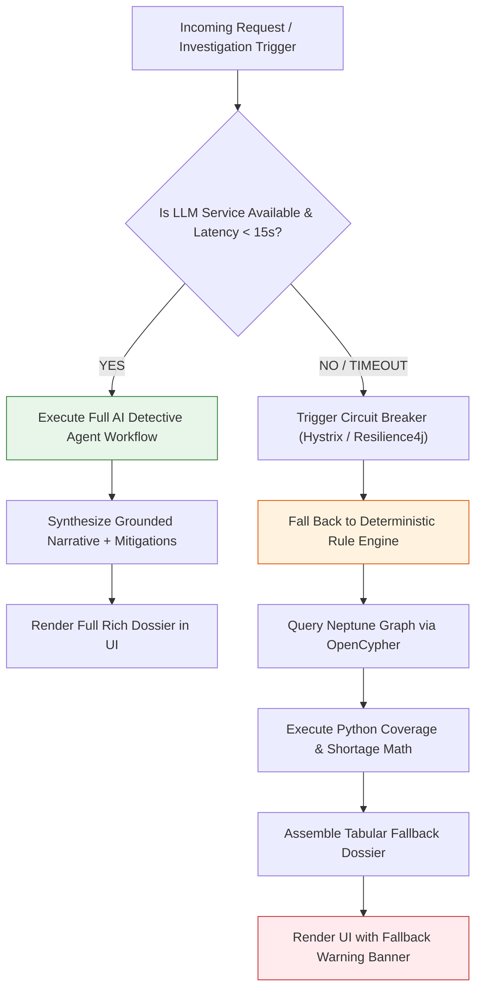

# FUNCTIONAL REQUIREMENTS DOCUMENT (FRD) / SYSTEM REQUIREMENTS SPECIFICATION (SRS)
## ApexMotion Supplier Risk Intelligence Platform
**Document Version:** 1.0  
**Status:** Approved for Implementation  
**Author:** Lead Systems Architect & Systems Analyst, Forward Deployment Engineering (FDE)  
**Standard Compliance:** AI Solution Architecture Masterclass (FRD / SRS Standard - Slide 6)  
**Traceability:** Mapped to BRD v1.0 and PRD v1.0

---

## 1. Purpose and System Overview

### 1.1 Purpose
This Functional Requirements Document (FRD) / System Requirements Specification (SRS) provides the complete, unambiguous, and testable technical specification of the behaviors, interfaces, business rules, data schemas, and error-handling mechanisms for the **ApexMotion Supplier Risk Intelligence Platform**. It translates the business rationale (defined in the BRD) and product user journeys (defined in the PRD) into exact functional specifications for software engineers, systems analysts, data engineers, and quality assurance teams.

### 1.2 System Overview
The ApexMotion Supplier Risk Intelligence Platform is an enterprise event-driven, decision-support system designed to identify, assess, and mitigate multi-tier supply chain disruptions 7 to 30 days before factory assembly lines stall. 

The system operates across six functional layers:
1. **Sensing Layer:** Ingests internal operational events from SAP ERP, Coupa, and MES alongside external telemetry (maritime AIS, news, weather, credit feeds), sanitizing all external unstructured text via a dedicated Quarantined Reader.
2. **Understanding Layer:** Normalizes supplier entities into master records, maintains a high-density Multi-Tier Knowledge Graph in Amazon Neptune (linking Tier-1 through Tier-3 nodes), and indexes digitized contracts in Amazon OpenSearch.
3. **Assessment Layer:** Executes deterministic computations (Days of Cover, burn rates, shortage gaps, financial loss exposure) via an isolated mathematical engine completely independent of LLM inference.
4. **Decision Layer:** Orchestrates a multi-agent investigation workflow (Detective Agent) that gathers evidence, validates hypotheses against the knowledge graph, and models ranked mitigation scenarios (air freight, dual-sourcing, production rebalancing).
5. **Action Layer:** Enforces Human-in-the-Loop (HITL) authorization via cryptographically signed approval tokens before generating draft purchase requisitions in SAP.
6. **Governance Layer:** Permanently archives raw signals, agent reasoning traces, deterministic calculations, and human approvals into a Write-Once-Read-Many (WORM) audit ledger with continuous CI evaluation gates.

```
┌────────────────────────────────────────────────────────────────────────────────────────┐
│                                SYSTEM BOUNDARY CONTEXT                                 │
├────────────────────────────────────────────────────────────────────────────────────────┤
│                                                                                        │
│   EXTERNAL INGESTION            ENTERPRISE CONNECTORS             SECURITY BOUNDARY    │
│   ┌───────────────────┐        ┌─────────────────────┐         ┌─────────────────────┐ │
│   │ Maritime AIS Feeds│        │ SAP S/4HANA (OData) │         │ Okta SSO / WebAuthn │ │
│   │ Global News Feeds │        │ Coupa Procurement   │         │ AWS KMS Key Vault   │ │
│   │ Weather / Seismic │        │ Siemens Teamcenter  │         │ S3 WORM Object Lock │ │
│   └─────────┬─────────┘        └──────────┬──────────┘         └──────────┬──────────┘ │
│             │                             │                               │            │
│             ▼                             ▼                               │            │
│     ┌───────────────┐             ┌───────────────┐                       │            │
│     │  QUARANTINED  │             │   EVENT BUS   │                       │            │
│     │    READER     │             │ (Amazon MSK)  │                       │            │
│     └───────┬───────┘             └───────┬───────┘                       │            │
│             │                             │                               │            │
│             └──────────────────────┬──────┘                               │            │
│                                    ▼                                      │            │
│                  ┌───────────────────────────────────┐                    │            │
│                  │  APEXMOTION RISK INTELLIGENCE     │                    │            │
│                  │           PLATFORM CORE           │◄───────────────────┘            │
│                  ├───────────────────────────────────┤                                 │
│                  │ • Multi-Tier Knowledge Graph      │                                 │
│                  │ • Deterministic Coverage Engine   │                                 │
│                  │ • Detective Agent Orchestrator    │                                 │
│                  │ • Scenario Simulation Service     │                                 │
│                  │ • HITL Approval Token Authority   │                                 │
│                  └─────────────────┬─────────────────┘                                 │
│                                    │                                                   │
│                                    ▼                                                   │
│                  ┌───────────────────────────────────┐                                 │
│                  │        ENTERPRISE OUTCOMES        │                                 │
│                  ├───────────────────────────────────┤                                 │
│                  │ • Risk Analyst Investigation UI   │                                 │
│                  │ • Sourcing Manager Action Console │                                 │
│                  │ • SAP S/4HANA Draft PO Revisions  │                                 │
│                  │ • Immutable WORM Audit Archive    │                                 │
│                  └───────────────────────────────────┘                                 │
│                                                                                        │
└────────────────────────────────────────────────────────────────────────────────────────┘
```

---

## 2. Functional Requirements with IDs

### 2.1 Sensing & Signal Ingestion (FR-SEN)

#### FR-SEN-001: Operational Event Ingestion
* **Description:** The system shall ingest live operational transactions from SAP S/4HANA, Coupa Procurement, and plant MES via dedicated Apache Kafka event topics.
* **Inputs:** 
  * Inventory balance updates (`inventory.balance.updated`)
  * Purchase order status events (`po.status.changed`)
  * Goods receipts at plant docks (`goods.receipt.created`)
  * Advanced Shipment Notices (`asn.shipment.transmitted`)
  * MES production consumption logs (`mes.line.consumption`)
* **Processing Logic:** 
  1. Validate event schema against Avro schema registry.
  2. Parse timestamp, plant identifier, part SKU, and transaction volume.
  3. Emit normalized operational event to internal event stream.
* **Outputs:** Validated internal operational event; database record update.
* **Error Handling:** Malformed payloads routed to Dead Letter Queue (DLQ) `dlq.operational.events` with error code `ERR_SCHEMA_INVALID`.

#### FR-SEN-002: External Disruption Feed Ingestion
* **Description:** The system shall ingest external disruption signals from global news feeds, meteorological agencies (GDACS/NOAA), seismic monitors, and maritime vessel tracking APIs (AIS).
* **Inputs:** Webhook notifications, REST polling responses, RSS feeds, AIS vessel geofence triggers.
* **Processing Logic:** 
  1. Receive raw JSON/XML/HTML payload.
  2. Record source identifier, capture timestamp, and external URL.
  3. Route raw text payload immediately to the Quarantined Reader.
* **Outputs:** Raw signal record stored in staging buffer; trigger message dispatched to Quarantined Reader.
* **Error Handling:** Network timeouts trigger exponential backoff retry (initial 5s, max 60s, 5 attempts).

#### FR-SEN-003: Quarantined Reader Payload Sanitization
* **Description:** The system shall isolate and sanitize all external unstructured textual data before submitting it to any downstream natural language processing or LLM workflow.
* **Inputs:** Raw external news article, social text, or supplier email.
* **Processing Logic:** 
  1. Strip all executable scripts, control characters, markdown execution directives, and SQL injection strings.
  2. Scan for prompt injection signatures (e.g., "Ignore previous instructions", "System override", "You are now").
  3. Enclose sanitized text in strict XML structural boundaries: `<untrusted_signal source="..." timestamp="..."> ... </untrusted_signal>`.
  4. Explicitly mark payload as passive data attributes; configure downstream model prompts to forbid instruction interpretation within untrusted tags.
* **Outputs:** Sanitized signal payload object with `is_sanitized: true` and calculated `injection_risk_score`.
* **Error Handling:** If `injection_risk_score` exceeds 0.85, quarantine payload in security review bucket and log alert `SEC_PROMPT_INJECTION_FLAGGED`.

#### FR-SEN-004: Multi-Source Signal Corroboration
* **Description:** The system shall validate external disruption events against multiple independent telemetry sources before promoting them to an active investigation incident.
* **Inputs:** Sanitized event signal; external corroborating data streams (e.g., news article + satellite thermal detection + carrier AIS delay).
* **Processing Logic:** 
  1. Calculate Event Confidence Score ($C$):
     $$C = \sum_{i=1}^{n} w_i \cdot S_i$$
     Where $S_i \in [0, 1]$ represents source reliability and $w_i$ is source weighting (Official Govt Bulletin = 0.40, AIS Satellite = 0.30, Verified News = 0.20, Social/Forum = 0.10).
  2. If $C \ge 0.75$, mark incident as `VERIFIED`.
  3. If $0.40 \le C < 0.75$, mark incident as `UNCONFIRMED_MONITORING`.
  4. If $C < 0.40$, discard as noise.
* **Outputs:** Promoted disruption record with confidence classification and corroborating source links.
* **Error Handling:** If primary source unreachable, default to unconfirmed state and set polling interval to 15 minutes.

---

### 2.2 Understanding & Multi-Tier Graph (FR-UND)

#### FR-UND-001: Master Entity Resolution
* **Description:** The system shall reconcile distinct naming conventions, vendor IDs, and manufacturer part numbers across SAP, Coupa, Teamcenter, and external feeds into unified Master Entity IDs.
* **Inputs:** Ingested supplier name string, tax ID, DUNS number, country code, MPN string.
* **Processing Logic:** 
  1. Strip corporate suffixes (e.g., "GmbH", "Corp", "Ltd", "Pte", "Co.").
  2. Query exact match on DUNS or Tax Registration ID in Master Vendor Directory.
  3. If no exact match, execute Jaro-Winkler phonetic and fuzzy distance matching against known supplier records.
  4. If string similarity $\ge 0.92$, link to existing Master Supplier ID; if between 0.75 and 0.91, queue for human data steward verification.
* **Outputs:** Unified Master Entity ID mapping (`master_supplier_id`).
* **Error Handling:** Unresolved entities assigned temporary ID `TEMP_SUP_XXXXX` with flag `NEEDS_STEWARDSHIP`.

#### FR-UND-002: Knowledge Graph Traversal & Blast-Radius Tracing
* **Description:** Given an impacted supplier node, the system shall traverse the Amazon Neptune Knowledge Graph to identify all upstream and downstream connected entities within 5 seconds.
* **Inputs:** `master_supplier_id` of disrupted entity.
* **Processing Logic:** 
  1. Execute OpenCypher multi-hop query:
     ```cypher
     MATCH path = (disrupted:Supplier {id: $supplier_id})
           <-[:SUPPLIES*1..3]-(inter:Component)
           -[:USED_IN]->(assembly:Assembly)
           -[:ASSEMBLED_AT]->(plant:Plant)
           -[:ALLOCATED_TO]->(program:VehicleProgram)
     RETURN path, disrupted, inter, assembly, plant, program
     ```
  2. Extract all impacted Tier-1 vendors, intermediate Tier-2 components, manufacturing plants (Munich, Bengaluru, Pune, Mexico, Vietnam, US), and vehicle lines.
  3. Compute graph path depth and identify single-point-of-failure bottlenecks.
* **Outputs:** Structured JSON Graph Blast-Radius Object containing node lists and relationship paths.
* **Error Handling:** If query execution exceeds 5,000 ms, terminate query, return cached neighborhood graph, and log `WARN_GRAPH_TIMEOUT`.

#### FR-UND-003: Contract Clause Intelligence Extraction
* **Description:** The system shall extract structured legal and commercial clauses from digitized PDF supplier agreements stored in Amazon OpenSearch.
* **Inputs:** Digitized PDF contract documents; target `master_supplier_id`.
* **Processing Logic:** 
  1. Retrieve contract chunks matching semantic search for `Force Majeure`, `Expedited Freight`, `Dual Sourcing`, and `Late Delivery SLA`.
  2. Extract exact clause parameters:
     * Minimum guaranteed notice period (days)
     * Penalty percentage per calendar day of delivery delay
     * Surcharge liability for emergency air freight conversion
     * List of pre-authorized secondary manufacturing facilities or alternate vendors
  3. Ground extracted clauses with page number, section heading, and paragraph verbatim text.
* **Outputs:** Structured Contract Terms Object with verified source citations.
* **Error Handling:** If no active contract found, flag `CONTRACT_UNAVAILABLE` and apply standard corporate default commercial terms.

---

### 2.3 Assessment & Deterministic Calculation (FR-ASS)

#### FR-ASS-001: Deterministic Days of Cover Calculation
* **Description:** The system shall calculate the exact inventory runway (Days of Cover) for any specified component at any manufacturing plant using live ERP stock balances and verified consumption rates. Under no circumstances shall an LLM perform or modify this arithmetic.
* **Inputs:** 
  * `usable_inventory_on_hand` (Integer, from SAP S/4HANA)
  * `average_daily_consumption` (Float, from MES 30-day trailing rolling burn rate)
* **Processing Logic:** 
  1. Validate that `average_daily_consumption` > 0.
  2. Execute deterministic formula:
     $$\text{Days of Cover} = \frac{\text{usable\_inventory\_on\_hand}}{\text{average\_daily\_consumption}}$$
  3. Round quotient to two decimal places.
* **Outputs:** `days_of_cover` (Float, e.g., 7.68 Days).
* **Error Handling:** If `average_daily_consumption` == 0, return `days_of_cover = 999.0` and flag `WARN_ZERO_CONSUMPTION`.

#### FR-ASS-002: Deterministic Shortage Gap & Volume Estimation
* **Description:** The system shall determine whether an incoming purchase order will arrive before inventory is exhausted, calculating the exact deficit duration and unit shortage volume.
* **Inputs:** 
  * `days_of_cover` (Float)
  * `inbound_shipment_eta_days` (Float, derived from carrier ASN / AIS GPS transit tracking)
  * `average_daily_consumption` (Float)
* **Processing Logic:** 
  1. Calculate Shortage Gap in Days:
     $$\text{shortage\_gap\_days} = \max(0.0, \text{inbound\_shipment\_eta\_days} - \text{days\_of\_cover})$$
  2. If $\text{shortage\_gap\_days} > 0$:
     $$\text{projected\_unit\_shortage} = \text{shortage\_gap\_days} \times \text{average\_daily\_consumption}$$
  3. Round `projected\_unit\_shortage` up to nearest whole integer unit.
* **Outputs:** `shortage_gap_days` (Float), `projected_unit_shortage` (Integer).
* **Error Handling:** If inbound ETA is missing or unconfirmed, mark `inbound_eta_status: UNVERIFIED` and calculate shortage assuming zero inbound replenishment.

#### FR-ASS-003: Deterministic Financial Loss Exposure Quantification
* **Description:** The system shall quantify the total plant-level financial loss resulting from projected line downtime.
* **Inputs:** 
  * `shortage_gap_days` (Float)
  * `plant_hourly_shutdown_rate` (Float, e.g., Munich = €85,000/hr, Bengaluru = \$28,000/hr)
  * `affected_line_operating_hours_per_day` (Integer, typically 16 or 24 hours)
  * `daily_lost_gross_margin` (Float)
  * `oem_contractual_daily_breach_fine` (Float)
* **Processing Logic:** 
  1. Compute total downtime hours: 
     $$\text{downtime\_hours} = \text{shortage\_gap\_days} \times \text{affected\_line\_operating\_hours\_per\_day}$$
  2. Compute total line halt cost: 
     $$\text{line\_halt\_cost} = \text{downtime\_hours} \times \text{plant\_hourly\_shutdown\_rate}$$
  3. Compute total financial exposure:
     $$\text{total\_exposure\_usd} = \text{line\_halt\_cost} + (\text{shortage\_gap\_days} \times (\text{daily\_lost\_gross\_margin} + \text{oem\_contractual\_daily\_breach\_fine}))$$
* **Outputs:** `total_exposure_usd` (Float), itemized loss breakdown matrix.
* **Error Handling:** If plant downtime cost rates are unconfigured, default to standard tier-1 rate (\$50,000/hr) and flag `RATE_ESTIMATED`.

---

### 2.4 Decision & Agentic Investigation (FR-DEC)

#### FR-DEC-001: Automated Sub-90-Second Investigation Pipeline
* **Description:** Upon triggering an investigation, the Detective Agent workflow shall synthesize verified signals, graph dependencies, deterministic math, and contract terms into an Incident Case Dossier within 90.0 seconds at p95 latency.
* **Inputs:** Trigger signal payload; `master_supplier_id`; incident ID.
* **Processing Logic:** 
  1. Stage 1 (0–15s): Validate signal, sanitize text, invoke entity resolution.
  2. Stage 2 (16–35s): Execute Neptune graph traversal to extract blast radius and affected BOMs.
  3. Stage 3 (36–50s): Call SAP APIs to fetch inventory and open POs; invoke Deterministic Engine for Days of Cover and shortage math.
  4. Stage 4 (51–70s): Retrieve contract clauses from OpenSearch vector index.
  5. Stage 5 (71–85s): Synthesize structured case dossier with evidence citations and 3 mitigation scenarios.
  6. Stage 6 (86–90s): Persist case dossier to Aurora PostgreSQL, emit event `investigation.case.completed`, and render in UI.
* **Outputs:** Fully populated `IncidentCaseDossier` object.
* **Error Handling:** If execution exceeds 80 seconds, abort optional contract deep-search, assemble dossier with core graph and deterministic math, and flag `PARTIAL_TIMEOUT_DEGRADATION`.

#### FR-DEC-002: Evidence Grounding and Citation Verification
* **Description:** Every factual statement, date, part quantity, and supplier assertion in the AI-synthesized narrative must be bound to a verifiable source citation key.
* **Inputs:** AI draft summary; source artifact index.
* **Processing Logic:** 
  1. Scan text for claim tokens (e.g., "Fire at cleanroom 2", "Inbound shipment of 80,000 units on vessel").
  2. Verify that each claim token maps to an explicit source pointer `[Source_ID:Ref_Key]`.
  3. If an assertion lacks an identifiable reference key, purge the sentence from the summary.
* **Outputs:** Grounded narrative with interactive citation anchors.
* **Error Handling:** If hallucination detection filter detects an ungrounded claim, suppress narrative generation and render raw tabular data instead with warning `ERR_NARRATIVE_UNGROUNDED`.

#### FR-DEC-003: Prescriptive Mitigation Scenario Generation
* **Description:** For every confirmed component shortage, the system shall generate and rank three discrete mitigation options with cost-benefit metrics.
* **Inputs:** `projected_unit_shortage`, `shortage_gap_days`, `total_exposure_usd`, Approved Manufacturer List (AML), supplier contracts.
* **Processing Logic:** 
  1. *Scenario 1 (Logistics Acceleration):* Calculate cost to convert inbound ocean shipment to dedicated air charter. Inbound lead time reduced by 5.5 days. Cost: \$180,000. Downtime avoided: 1.3 days. Net Benefit: $+\$2,270,000$.
  2. *Scenario 2 (Secondary Sourcing):* Query AML for qualified alternate suppliers producing equivalent MPN. Calculate spot purchase cost and lead time (6.0 days). Cost: \$240,000. Downtime avoided: 0.5 days. Net Benefit: $+\$850,000$.
  3. *Scenario 3 (Production Line Rebalancing):* Calculate schedule reallocation shifting component allocation from standard vehicle models to premium high-margin models. Zero cash cost; partial revenue deferred.
  4. Rank scenarios based on `Net Financial Benefit = Avoided Loss - Execution Cost`.
* **Outputs:** Array of 3 ranked `MitigationScenario` objects.
* **Error Handling:** If no approved alternate supplier exists in AML, mark Scenario 2 as `UNAVAILABLE_NO_QUALIFIED_SOURCE`.

---

### 2.5 Action & Human Governance (FR-ACT)

#### FR-ACT-001: Mandatory Human Approval Gating (HITL)
* **Description:** The system shall strictly prohibit autonomous execution of financial commitments, purchase order amendments, or supplier notifications. All actions require authenticated human sign-off.
* **Inputs:** Selected `MitigationScenario`; authenticated user session.
* **Processing Logic:** 
  1. Intercept action request.
  2. Evaluate requested financial commitment against authorized spend thresholds:
     * Tier 1 ($\le \$25,000$): Requires single signature of Category Sourcing Manager.
     * Tier 2 ($\$25,001 - \$100,000$): Requires signature of Global Procurement Director.
     * Tier 3 ($> \$100,000$): Requires dual signatures (Director + VP Global Supply Chain).
  3. Generate pending `ApprovalRequest` record with timeout of 4 hours.
* **Outputs:** Pending approval state; push notifications dispatched to designated signers.
* **Error Handling:** If approval request times out without signature, escalate via SMS/PagerDuty to Executive On-Call.

#### FR-ACT-002: Cryptographic Approval Token Generation & Verification
* **Description:** Approved actions must be validated through a time-bound, cryptographically signed approval token.
* **Inputs:** User identity, role, timestamp, action parameters, private key / WebAuthn signature.
* **Processing Logic:** 
  1. Upon successful biometric or MFA authentication, construct approval payload:
     `Payload = SHA256(user_id + case_id + action_id + spend_amount + timestamp)`
  2. Sign payload using system ECDSA P-256 private key stored in AWS KMS Key Vault.
  3. Set token time-to-live (TTL) to exactly 15 minutes.
  4. Verify token signature prior to dispatching any transaction to external APIs.
* **Outputs:** Cryptographic `ApprovalToken` string.
* **Error Handling:** Expired or tampered tokens rejected with error `SEC_TOKEN_INVALID`; security incident logged.

#### FR-ACT-003: Controlled Action Drafting & Enterprise API Dispatch
* **Description:** Upon validation of the approval token, the system shall generate structured draft artifacts and dispatch them to target enterprise transactional systems.
* **Inputs:** Validated `ApprovalToken`; approved `MitigationScenario`.
* **Processing Logic:** 
  1. Format draft payload:
     * For SAP S/4HANA: Construct `PurchaseRequisitionAmendment` OData payload with updated shipping condition code `01` (Air Freight) and updated delivery date.
     * For Freight Forwarder: Construct EDI 211 / JSON logistics expedite dispatch instruction.
  2. Dispatch payload via mutual TLS (mTLS) to enterprise gateway.
  3. Capture external transaction confirmation reference ID (e.g., SAP Document #).
* **Outputs:** `ActionExecutionResult` record containing SAP document reference.
* **Error Handling:** If SAP API returns HTTP 5xx or connection timeout, initiate retry queue with max 3 attempts; if unfulfilled, alert IT Operations desk.

---

### 2.6 Governance, Audit & Continuous Evaluation (FR-GOV)

#### FR-GOV-001: Tamper-Evident WORM Audit Ledger Logging
* **Description:** The system shall permanently archive an immutable, chronologically ordered audit record of every incident stage, prompt, calculation, and decision.
* **Inputs:** Ingested signal, model prompt/completion, deterministic inputs/outputs, user approval token, external API dispatch receipt.
* **Processing Logic:** 
  1. Assemble complete transaction audit envelope.
  2. Compute cryptographic SHA-256 digest of audit envelope and append previous block hash (Merkle chain).
  3. Write record to Amazon Aurora PostgreSQL audit table.
  4. Asynchronously replicate block to Amazon S3 bucket with **S3 Object Lock** enabled in **Compliance Mode** (WORM - Write Once Read Many) with a 7-year mandatory retention policy.
* **Outputs:** Immutable audit ledger entry with verifiable cryptographic hash.
* **Error Handling:** If write to WORM storage fails, halt action pipeline, sound critical security alarm, and alert CISO team.

#### FR-GOV-002: Continuous Automated Evaluation (Evals in CI)
* **Description:** The system shall execute automated regression evaluation suites against designated "Golden Datasets" during CI/CD builds and weekly production monitoring.
* **Inputs:** Historical incident benchmark dataset (including NanoCore Cleanroom Fire Incident SR-2026-091); model prompt versions.
* **Processing Logic:** 
  1. Execute automated test run across 50 benchmark disruption scenarios.
  2. Measure performance against defined thresholds:
     * Entity Extraction F1-Score $\ge 0.95$
     * Graph Traversal Accuracy $= 100\%$
     * Deterministic Mathematical Consistency $= 100\%$ (Zero error tolerance)
     * Groundedness / Citation Verification Score $\ge 0.98$
  3. Compare results against baseline benchmark; automatically fail CI build if regression is detected.
* **Outputs:** Automated Evaluation Report; pass/fail deployment gate status.
* **Error Handling:** CI deployment blocked on any evaluation metric failure.

---

## 3. Business Rules and Validations

```
┌────────────────────────────────────────────────────────────────────────┐
│                        CORE BUSINESS RULES MATRIX                      │
├─────────────┬──────────────────────────────────────────────────────────┤
│ RULE ID     │ FORMAL RULE SPECIFICATION & VALIDATION CONSTRAINT        │
├─────────────┼──────────────────────────────────────────────────────────┤
│ BR-RULE-001 │ TRIAD SEPARATION: LLMs SHALL NOT PERFORM ARITHMETIC      │
│             │ All mathematical formulas must execute via verified      │
│             │ Python deterministic modules. Model math is forbidden.   │
├─────────────┼──────────────────────────────────────────────────────────┤
│ BR-RULE-002 │ ZERO-HALLUCINATION POLICY                                │
│             │ Every claim in an AI dossier must resolve to a valid     │
│             │ source citation. Unsupported assertions are purged.      │
├─────────────┼──────────────────────────────────────────────────────────┤
│ BR-RULE-003 │ MANDATORY HITL AUTHORIZATION                             │
│             │ Zero autonomous financial spend or PO execution. All     │
│             │ external actions require a cryptographically signed token│
├─────────────┼──────────────────────────────────────────────────────────┤
│ BR-RULE-004 │ DUAL SIGNATURE THRESHOLD                                 │
│             │ Any mitigation action exceeding USD 100,000 requires dual│
│             │ sign-off (Procurement Director + VP Supply Chain).       │
├─────────────┼──────────────────────────────────────────────────────────┤
│ BR-RULE-005 │ AML QUALIFICATION REQUIREMENT                            │
│             │ Secondary suppliers must exist on Approved Manufacturer  │
│             │ List (AML) with active quality certification.            │
├─────────────┼──────────────────────────────────────────────────────────┤
│ BR-RULE-006 │ QUARANTINED DATA ENCAPSULATION                           │
│             │ External text must be enclosed in untrusted tags and     │
│             │ stripped of command syntax prior to model inference.     │
├─────────────┼──────────────────────────────────────────────────────────┤
│ BR-RULE-007 │ WORM AUDIT IMMUTABILITY                                  │
│             │ Audit logs must write to S3 Object Lock Compliance Mode. │
│             │ Modification or deletion is cryptographically blocked.   │
└─────────────┴──────────────────────────────────────────────────────────┘
```

### Detailed Rule Specifications
* **BR-RULE-001 (The Triad of Responsibility):**
  * *Condition:* When calculating `days_of_cover`, `shortage_gap_days`, `projected_unit_shortage`, or `total_exposure_usd`.
  * *Constraint:* Execution must occur exclusively within compiled deterministic Python service classes (`app.services.deterministic.*`). The LLM prompt context is strictly restricted to consuming the completed numerical output for narrative phrasing; the LLM is prohibited from calculating or re-estimating values.
* **BR-RULE-002 (Inventory Coverage Calculation Rule):**
  * *Condition:* Calculation of component runway.
  * *Logic:* $\text{Days of Cover} = \text{Usable Stock on Hand} \div \text{Rolling 30-Day Daily Consumption Rate}$.
  * *Validation:* If stock on hand $< 0$, throw validation exception `DATA_CORRUPT_NEGATIVE_INVENTORY`. If daily consumption $\le 0$, flag inventory as stagnant.
* **BR-RULE-003 (Financial Spend Authorization Tiers):**
  * *Condition:* Execution of spend-bearing mitigation plans.
  * *Validation:*
    * Spend $\le \$25,000$: Signer must possess role `ROLE_CATEGORY_MANAGER` or higher.
    * $\$25,000 < \text{Spend} \le \$100,000$: Signer must possess role `ROLE_PROCUREMENT_DIRECTOR`.
    * Spend $> \$100,000$: Signer 1 must possess `ROLE_PROCUREMENT_DIRECTOR`; Signer 2 must possess `ROLE_VP_SUPPLY_CHAIN` or `ROLE_CFO`.
* **BR-RULE-004 (Secondary Source Qualification):**
  * *Condition:* Modeling alternate supplier activation.
  * *Constraint:* An alternate supplier can only be recommended if `is_aml_qualified == true` in Siemens Teamcenter and active component quality defect rate $< 1.0\%$.

---

## 4. Use Cases and Detailed System Flows

### 4.1 UC-01: Ingestion & Corroboration of External Disruption Signal
* **Primary Actor:** External Signal Monitor (Automated Worker).
* **Pre-conditions:** Signal Hub connectors are operational; Kafka broker cluster is healthy.
* **Trigger:** RSS/Webhook payload received reporting industrial fire in Hsinchu, Taiwan.
* **Main Success Scenario (Sunny Day):**
  1. Ingestion service captures raw payload from Taiwan Industrial News RSS feed.
  2. Payload is transmitted to the Quarantined Reader.
  3. Quarantined Reader sanitizes content, strips HTML/scripts, evaluates prompt injection score ($0.02$), and wraps content in `<untrusted_signal>` tags.
  4. Signal Corroborator queries GDACS disaster feed and local emergency dispatch logs, computing confidence score $C = 0.94$.
  5. Entity Resolution extracts "NanoCore Semiconductor", resolving it to Master Entity ID `SUP-NC-882`.
  6. Disruption event published to Kafka topic `disruption.events.verified`.
* **Alternative Flow (Unconfirmed Noise):**
  * *4a.* Corroborating feeds show zero matching reports ($C = 0.25$).
  * *4b.* System marks event as `NOISE_DISCARDED`, persists record to staging log, and halts pipeline.
* **Post-conditions:** Verified disruption event available for automated investigation.

---

### 4.2 UC-02: Automated Sub-90-Second Investigation (The NanoCore Fire)
* **Primary Actor:** Alex Chen (Risk Analyst) / Automated Event Trigger.
* **Pre-conditions:** Incident SR-2026-091 verified on event bus.
* **Trigger:** Analyst clicks "Trigger Investigation" (or auto-triggered for High-Severity signals).
* **Main Success Scenario (Sunny Day):**
  1. Detective Agent orchestrator initializes case state in LangGraph.
  2. Agent executes OpenCypher query against Amazon Neptune Knowledge Graph for `SUP-NC-882`.
  3. Graph returns dependency path: `NanoCore [Tier-2]` $\rightarrow$ supplies `MCU-X91` $\rightarrow$ `BetaElectro [Tier-1]` $\rightarrow$ supplies `Battery ECU` $\rightarrow$ assembled at `Munich, Bengaluru, and Pune` plants $\rightarrow$ allocated to `Hyper-GT and Urban-E` vehicle programs.
  4. Agent queries SAP OData service:
     * Usable Stock on Hand = 142,000 units.
     * Inbound Shipment PO #88921 = 80,000 units on vessel ETA 9.0 days.
  5. Agent queries MES service: Average daily consumption across 3 plants = 18,500 units/day.
  6. Agent invokes Deterministic Calculation Engine:
     * Days of Cover: $142,000 \div 18,500 = 7.7$ Days.
     * Shortage Gap: $9.0 - 7.7 = 1.3$ Days.
     * Net Shortage Volume: $1.3 \times 18,500 = 24,050$ units.
     * Financial Downtime Exposure: \$2,450,000 across plants.
  7. Agent queries OpenSearch for BetaElectro and NanoCore contracts, extracting force majeure and expedited delivery clauses.
  8. Agent generates 3 ranked mitigation scenarios and compiles structured Case Dossier.
  9. Elapsed execution time recorded: 82.4 seconds. Dossier rendered in UI.
* **Alternative Flow (Graceful Degradation on LLM Timeout):**
  * *8a.* External LLM API fails to respond within 20 seconds.
  * *8b.* System triggers circuit breaker, falling back to Deterministic Template Engine.
  * *8c.* UI displays exact numerical calculations and raw graph blast radius with banner: `AI Narrative Service Degraded - Running in Deterministic Fallback Mode`.
* **Post-conditions:** Complete incident dossier rendered; audit log persisted.

```mermaid
sequenceDiagram
    autonumber
    actor Analyst as Risk Analyst
    participant UI as Web Frontend
    participant Orch as Agent Orchestrator
    participant Graph as Neptune Graph DB
    participant SAP as SAP S/4HANA API
    participant Math as Deterministic Engine
    participant LLM as Managed Bedrock LLM
    participant WORM as S3 WORM Audit Ledger

    Analyst->>UI: Clicks "Trigger Investigation" (SR-2026-091)
    UI->>Orch: Start Investigation (SUP-NC-882)
    Orch->>Graph: Query Multi-Tier Dependency Path
    Graph-->>Orch: Returns MCU-X91 -> BetaElectro -> Battery ECU -> Plants
    Orch->>SAP: Get Stock Balance & Open Inbound POs
    SAP-->>Orch: Stock = 142,000; Inbound = 80,000 (ETA 9.0d)
    Orch->>Math: Compute Cover, Shortage, & Financial Exposure
    Note over Math: Strictly Deterministic Python Code<br/>Cover = 7.7d, Gap = 1.3d, Shortage = 24,050 units
    Math-->>Orch: Returns Exact Numerical Assessment
    Orch->>LLM: Synthesize Grounded Dossier & Mitigations
    LLM-->>Orch: Structured Dossier JSON + Citations
    Orch->>WORM: Archive Transaction Block & Prompt Hashes
    WORM-->>Orch: Hash Confirmed (SHA-256)
    Orch-->>UI: Complete Dossier Rendered (<90s Total Latency)
```

---

### 4.3 UC-03: Prescriptive Mitigation Modeling & Human Authorization
* **Primary Actor:** Priya Sharma (Category Sourcing Manager).
* **Pre-conditions:** Incident Dossier SR-2026-091 active; user authenticated with appropriate role.
* **Trigger:** Sourcing Manager reviews proposed mitigation scenarios on workbench.
* **Main Success Scenario (Sunny Day):**
  1. Sourcing Manager reviews 3 mitigation options:
     * Option 1: Air Freight Expedite (\$180k cost, 3.5-day delivery, saves line halt).
     * Option 2: Spot Sourcing (\$240k cost, 6.0-day delivery, 1.7 days downtime).
     * Option 3: Line Rebalancing (\$450k margin impact, zero cash spend).
  2. Manager selects Option 1 (Air Freight Expedite) and enters justification notes.
  3. System determines spend is \$180,000, requiring dual authorization (BR-RULE-003).
  4. Sourcing Manager provides primary biometric approval via WebAuthn.
  5. System sends urgent mobile push notification to Dr. Elena Rostova (VP Global Supply Chain).
  6. VP reviews case on mobile app and authorizes via biometric touch ID.
  7. Approval Token Service validates both signatures and generates cryptographic `ApprovalToken`.
  8. System calls SAP S/4HANA OData API, generating draft Purchase Requisition amendment to PO #88921 specifying air freight routing.
  9. SAP returns confirmed reservation document #`PR-2026-009182`.
  10. Immutable audit ledger updated with token and SAP transaction receipt.
* **Post-conditions:** Action drafted and confirmed in SAP; plant stockout averted.

---

## 5. Data Requirements and Schemas

### 5.1 JSON Data Schemas

#### Schema 1: Incident Case Dossier Schema (`incident_case_dossier.json`)
```json
{
  "$schema": "http://json-schema.org/draft-07/schema#",
  "title": "IncidentCaseDossier",
  "type": "object",
  "required": [
    "case_id",
    "incident_id",
    "disrupted_supplier",
    "confidence_score",
    "graph_blast_radius",
    "deterministic_assessment",
    "mitigation_scenarios",
    "status",
    "created_at"
  ],
  "properties": {
    "case_id": { "type": "string", "pattern": "^CASE-[0-9]{4}-[0-9]{6}$" },
    "incident_id": { "type": "string", "pattern": "^SR-[0-9]{4}-[0-9]{3}$" },
    "disrupted_supplier": {
      "type": "object",
      "required": ["master_supplier_id", "supplier_name", "tier_level", "country"],
      "properties": {
        "master_supplier_id": { "type": "string" },
        "supplier_name": { "type": "string" },
        "tier_level": { "type": "integer", "enum": [1, 2, 3] },
        "country": { "type": "string", "minLength": 2, "maxLength": 2 }
      }
    },
    "confidence_score": { "type": "number", "minimum": 0.0, "maximum": 1.0 },
    "graph_blast_radius": {
      "type": "object",
      "required": ["impacted_components", "impacted_plants", "impacted_programs"],
      "properties": {
        "impacted_components": { "type": "array", "items": { "type": "string" } },
        "impacted_plants": { "type": "array", "items": { "type": "string" } },
        "impacted_programs": { "type": "array", "items": { "type": "string" } }
      }
    },
    "deterministic_assessment": {
      "type": "object",
      "required": [
        "usable_inventory_units",
        "daily_consumption_units",
        "days_of_cover",
        "inbound_eta_days",
        "shortage_gap_days",
        "projected_unit_shortage",
        "total_financial_exposure_usd"
      ],
      "properties": {
        "usable_inventory_units": { "type": "integer" },
        "daily_consumption_units": { "type": "number" },
        "days_of_cover": { "type": "number" },
        "inbound_eta_days": { "type": "number" },
        "shortage_gap_days": { "type": "number" },
        "projected_unit_shortage": { "type": "integer" },
        "total_financial_exposure_usd": { "type": "number" }
      }
    },
    "mitigation_scenarios": {
      "type": "array",
      "minItems": 1,
      "maxItems": 5,
      "items": {
        "type": "object",
        "required": ["scenario_id", "scenario_type", "estimated_cost_usd", "lead_time_days", "net_benefit_usd"],
        "properties": {
          "scenario_id": { "type": "string" },
          "scenario_type": { "type": "string", "enum": ["LOGISTICS_EXPEDITE", "SECONDARY_SOURCE", "LINE_REBALANCE"] },
          "estimated_cost_usd": { "type": "number" },
          "lead_time_days": { "type": "number" },
          "net_benefit_usd": { "type": "number" }
        }
      }
    },
    "status": { "type": "string", "enum": ["INVESTIGATING", "READY_FOR_REVIEW", "APPROVED", "REJECTED", "EXECUTED"] },
    "created_at": { "type": "string", "format": "date-time" }
  }
}
```

#### Schema 2: Cryptographic Approval Token Schema (`approval_token.json`)
```json
{
  "$schema": "http://json-schema.org/draft-07/schema#",
  "title": "ApprovalToken",
  "type": "object",
  "required": [
    "token_id",
    "case_id",
    "scenario_id",
    "authorized_spend_usd",
    "primary_signer",
    "signature_hash",
    "expires_at"
  ],
  "properties": {
    "token_id": { "type": "string", "format": "uuid" },
    "case_id": { "type": "string" },
    "scenario_id": { "type": "string" },
    "authorized_spend_usd": { "type": "number" },
    "primary_signer": {
      "type": "object",
      "required": ["user_id", "user_email", "role", "signed_at"],
      "properties": {
        "user_id": { "type": "string" },
        "user_email": { "type": "string", "format": "email" },
        "role": { "type": "string" },
        "signed_at": { "type": "string", "format": "date-time" }
      }
    },
    "secondary_signer": {
      "type": "object",
      "properties": {
        "user_id": { "type": "string" },
        "user_email": { "type": "string", "format": "email" },
        "role": { "type": "string" },
        "signed_at": { "type": "string", "format": "date-time" }
      }
    },
    "signature_hash": { "type": "string", "pattern": "^[a-f0-9]{64}$" },
    "expires_at": { "type": "string", "format": "date-time" }
  }
}
```

---

### 5.2 Knowledge Graph Data Model (Amazon Neptune)

```
┌────────────────────────────────────────────────────────────────────────┐
│                     KNOWLEDGE GRAPH SCHEMA TOPOLOGY                    │
├────────────────────────────────────────────────────────────────────────┤
│                                                                        │
│   (Supplier:Tier3)                                                     │
│          │                                                             │
│          │ [:EXTRACTS_OR_REFINES]                                      │
│          ▼                                                             │
│   (Material:RawLithium)                                                │
│          │                                                             │
│          │ [:USED_IN_COMPONENT]                                        │
│          ▼                                                             │
│   (Supplier:Tier2) ──[:SUPPLIES_PART]──► (Component:MCU_X91)           │
│    (NanoCore)                                   │                      │
│                                                 │ [:SUBCONTRACTED_TO]  │
│                                                 ▼                      │
│   (Supplier:Tier1) ◄────────────────── (Assembly:BatteryECU)           │
│    (BetaElectro)                                │                      │
│                                                 │ [:ASSEMBLED_AT]      │
│                                                 ▼                      │
│                                         (Plant:MunichPlant)            │
│                                                 │                      │
│                                                 │ [:ALLOCATED_TO]      │
│                                                 ▼                      │
│                                      (Program:ApexHyperGT)             │
│                                                                        │
└────────────────────────────────────────────────────────────────────────┘
```

#### Node Definitions & Properties
| Node Label | Key Identifiers | Required Properties | Sample Node Record |
| :--- | :--- | :--- | :--- |
| `:Supplier` | `master_supplier_id` | `name`, `tier_level` (1, 2, 3), `country`, `risk_rating`, `aml_status` | `(:Supplier {id: 'SUP-NC-882', name: 'NanoCore Semiconductor', tier_level: 2, country: 'TW'})` |
| `:Component`| `mpn` | `internal_sku`, `description`, `commodity_category`, `is_critical` | `(:Component {mpn: 'MCU-X91', internal_sku: 'SKU-77291', category: 'Semiconductors'})` |
| `:Assembly` | `assembly_id` | `bom_revision`, `name`, `gross_weight_kg` | `(:Assembly {assembly_id: 'ASM-BECU-04', bom_rev: '4.2', name: 'High-Voltage Battery ECU'})` |
| `:Plant`    | `plant_id` | `name`, `country`, `hourly_downtime_rate_usd`, `active_lines` | `(:Plant {plant_id: 'PLT-MUC-01', name: 'Munich Assembly Hub', country: 'DE', rate: 92000.0})` |
| `:Program`  | `program_id` | `vehicle_model_name`, `daily_target_units`, `margin_per_unit_usd` | `(:Program {program_id: 'PRG-HGT-2026', model: 'Apex Hyper-GT', margin: 14500.0})` |

#### Edge Definitions
* `(:Supplier)-[:SUPPLIES_PART {lead_time_days: 45, is_single_source: true}]->(:Component)`
* `(:Component)-[:PART_OF_BOM {quantity_per_assembly: 2}]->(:Assembly)`
* `(:Assembly)-[:ASSEMBLED_AT {primary_line: 'Line-B'}]->(:Plant)`
* `(:Plant)-[:ALLOCATED_TO {daily_build_quota: 250}]->(:Program)`

---

## 6. Interfaces and Integrations

```
┌────────────────────────────────────────────────────────────────────────┐
│                        INTEGRATION INTERFACE MAP                       │
├──────────────────┬─────────────────┬───────────────┬───────────────────┤
│ SYSTEM / FEED    │ PROTOCOL / TYPE │ DATA FORMAT   │ FREQUENCY / MODE  │
├──────────────────┼─────────────────┼───────────────┼───────────────────┤
│ SAP S/4HANA      │ OData v4 / RFC  │ JSON / BAPI   │ Real-time Event   │
│ Coupa Procure    │ REST API        │ JSON          │ Hourly Sync       │
│ Teamcenter PLM   │ REST API / XML  │ XML / JSON    │ Daily Delta / Webh│
│ Plant MES Logs   │ Kafka Producer  │ Avro / JSON   │ Sub-minute stream │
│ Maritime AIS     │ WebSocket / REST│ GeoJSON       │ Continuous (10m)  │
│ Global News / RSS│ Webhook / Poll  │ Raw RSS / XML │ 5-minute polling  │
│ Okta Identity    │ OIDC / SAML 2.0 │ JWT Tokens    │ Per Request AuthN │
└──────────────────┴─────────────────┴───────────────┴───────────────────┘
```

### 6.1 Inbound Interfaces

#### INT-IN-001: SAP S/4HANA OData Connector
* **Endpoint:** `https://sap.apexmotion.internal/sap/opu/odata4/sap/api_purchaseorder_2/srvd_a2x/sap/purchaseorder/0001/`
* **Method:** `GET` / `POST`
* **Authentication:** OAuth 2.0 mTLS client certificate authentication.
* **Payload Query:** Filter on open purchase orders by component SKU and plant code.
* **Data Exchanged:** PO Number, Line Item, Component SKU, Order Quantity, Confirmed Delivery Date, Supplier Vendor ID.

#### INT-IN-002: Maritime AIS Vessel Tracking Feed
* **Endpoint:** `wss://stream.marinetraffic.com/v1/vessels`
* **Protocol:** Secure WebSockets.
* **Data Exchanged:** IMO Number, MMSI, Current Latitude/Longitude, Destination Port, Current Speed, Calculated ETA, Deviation Status.

#### INT-IN-003: Plant MES Real-Time Consumption Stream
* **Topic:** `mes.production.consumption.v1`
* **Format:** Apache Avro serialized binary.
* **Fields:** `timestamp`, `plant_id`, `line_id`, `component_sku`, `units_consumed_last_hour`, `scrap_defect_units`.

### 6.2 Outbound Interfaces

#### INT-OUT-001: SAP S/4HANA Purchase Requisition Amendment
* **Endpoint:** `https://sap.apexmotion.internal/sap/opu/odata4/sap/api_purchaserequisition/0001/PurchaseRequisitionItem`
* **Method:** `PATCH`
* **Authentication:** OAuth 2.0 Bearer token accompanied by `x-approval-token` header.
* **Sample Payload:**
  ```json
  {
    "PurchaseRequisition": "10029912",
    "PurchaseRequisitionItem": "00010",
    "ShippingCondition": "01",
    "DeliveryDate": "2026-03-26T00:00:00Z",
    "Supplier": "VEND-BETAELECTRO-01",
    "ItemText": "Emergency air freight conversion authorized via Risk Intelligence Platform Case SR-2026-091"
  }
  ```

#### INT-OUT-002: Critical Incident PagerDuty & Slack Dispatch
* **Protocol:** HTTPS REST Webhook.
* **Payload:** Formatted JSON card containing Incident ID, Severity, Shortage Gap, Dollar Impact, and direct deep-link to the Case Dossier Workbench.

---

## 7. Non-Functional Requirements (NFRs)

```
┌────────────────────────────────────────────────────────────────────────┐
│                    NON-FUNCTIONAL SYSTEM TARGETS (SLAs)                │
├────────────────────────────────────────┬───────────────────────────────┤
│ ARCHITECTURAL ATTRIBUTE                │ PRODUCTION REQUIREMENT        │
├────────────────────────────────────────┼───────────────────────────────┤
│ Incident Investigation Latency (p95)   │ <= 90 Seconds                 │
│ Knowledge Graph Traversal Time (p99)   │ <= 5.0 Seconds                │
│ Deterministic Calculation Latency (p99)│ <= 200 Milliseconds           │
│ Streaming Event Ingestion Throughput   │ Avg 12.8 ev/s, Peak 1,285 ev/s│
│ System Availability (Uptime SLA)       │ 99.9% (<= 8.76 hrs down/year) │
│ Recovery Point Objective (RPO)         │ <= 5 Minutes (In-region)      │
│ Recovery Time Objective (RTO)          │ <= 4 Hours (Regional Disaster)│
│ Audit Ledger Immutability              │ 100% WORM Compliance (7 years)│
└────────────────────────────────────────┴───────────────────────────────┘
```

### 7.1 Performance & Latency Requirements
* **NFR-PERF-01 (Investigation Latency):** The end-to-end processing latency for an automated incident investigation—from verified signal ingestion to complete dossier rendering—shall not exceed **90.0 seconds at p95** and **120.0 seconds at p99**.
* **NFR-PERF-02 (Graph Query Latency):** Multi-hop dependency graph traversals up to 4 degrees of separation in Amazon Neptune shall complete in **$\le 5.0$ seconds at p99**.
* **NFR-PERF-03 (Calculation Speed):** Deterministic calculations for Days of Cover and financial exposure shall complete in **$\le 200$ milliseconds**.
* **NFR-PERF-04 (UI Rendering):** The Web Client UI shall render the Global Command Center map and active alerts in **$\le 1.5$ seconds** over corporate WAN.

### 7.2 Scalability & Throughput Requirements
* **NFR-SCAL-01 (Event Ingestion Capacity):** The ingestion tier (Amazon MSK + Kafka Connect) shall sustain a steady-state load of **1,110,000 events/day (~12.8 events/sec)** and smoothly scale via KEDA auto-scaling to absorb peak burst rates of **1,285 events/sec** without dropping messages.
* **NFR-SCAL-02 (Concurrent User Investigations):** The platform shall support up to **50 concurrent analyst investigations** without degrading response latency past 90 seconds.
* **NFR-SCAL-03 (Corpus Sizing):** The vector search and document intelligence engine shall index and query a repository of at least **60,000 PDF contracts (~1.2M pages / ~3M vector chunks)**.

### 7.3 Availability, Resilience & Disaster Recovery
* **NFR-REL-01 (High Availability):** The platform shall maintain **99.9% availability** during business operating hours across all 5 plant time zones.
* **NFR-REL-02 (Disaster Recovery):** 
  * In-region Recovery Point Objective (RPO): $\le 5$ minutes via Aurora continuous storage replication.
  * Multi-region Recovery Time Objective (RTO): $\le 4$ hours for regional disaster failover.
* **NFR-REL-03 (Data Loss Zero Tolerance):** The audit ledger and human approval token store shall have an RPO of **0 seconds** (zero data loss guaranteed via synchronous transactional commit before action dispatch).

### 7.4 Security, Privacy & Data Residency
* **NFR-SEC-01 (Encryption in Transit & at Rest):** All network communications must enforce TLS 1.3. All databases, vector stores, and S3 buckets must be encrypted at rest using customer-managed AWS KMS keys (AES-256).
* **NFR-SEC-02 (Zero Public LLM Leakage):** No proprietary BOM designs, component costs, contract clauses, or supplier details shall be transmitted to public foundational model APIs. All model inference must execute via private Amazon Bedrock VPC endpoints or dedicated self-hosted vLLM GPU clusters.
* **NFR-SEC-03 (Data Sovereignty):** German plant manufacturing and supplier data must reside within the AWS Frankfurt (`eu-central-1`) region to satisfy EU GDPR and LkSG regulations. Indian plant records must remain within AWS Mumbai (`ap-south-1`).

---

## 8. Error Handling, Resilience, and Graceful Degradation



### 8.1 Graceful Degradation Architecture
In accordance with core enterprise reliability principles, the platform is designed to degrade gracefully if any cognitive AI component fails:

| Component Failure | Failure Detection Mechanism | Automated Fallback State | Operational Impact |
| :--- | :--- | :--- | :--- |
| **External LLM Provider Outage** *(Bedrock / vLLM)* | HTTP 5xx errors or request timeout $> 15.0$ seconds across 3 attempts. | **Deterministic Fallback Engine:** Platform disables narrative text synthesis; UI renders raw graph topology, live SAP inventory balances, and exact Days of Cover math tables. | Sourcing managers can still see exact shortage dates and dollar exposures; narrative commentary is omitted. |
| **Vector Database Failure** *(OpenSearch)* | Connection timeout $> 5.0$ seconds. | System bypasses semantic contract search; displays metadata-linked contracts directly via PDF viewer; applies default corporate SLAs. | Analysts manually read contract PDFs; core shortage calculations remain unaffected. |
| **Knowledge Graph Latency** *(Amazon Neptune)* | Query timeout $> 5.0$ seconds. | System queries read-replica cache; if unavailable, loads pre-indexed 24-hour snapshot from Amazon Aurora PostgreSQL. | Graph reflects 24-hour cached relationships; live inventory math remains real-time. |
| **SAP S/4HANA API Unreachable** | HTTP 503 / Network timeout. | System loads last-known inventory balance from Redis operational cache with visual badge `CACHE_DATA_AGE: XX mins`. | Mathematical calculations continue using cached stock levels; draft PO dispatch is queued. |

### 8.2 Failure Modes and Effects Analysis (FMEA)

| Failure Mode ID | Failure Description | Root Cause | System Response & Recovery Action | Severity |
| :--- | :--- | :--- | :--- | :--- |
| **FMEA-01** | Prompt Injection Attack in Ingested News | Adversarial payload embedded in foreign RSS feed attempting to reset model prompt. | Quarantined Reader sanitizes payload; strips instruction tokens; tags text as passive data; logs security incident `SEC_PROMPT_INJECTION_DETECTED`. | **Critical** |
| **FMEA-02** | Zero/Negative Inventory Balance in ERP | SAP master data entry error or unposted warehouse goods issue. | Deterministic engine flags exception `DATA_ANOMALY_NEGATIVE_STOCK`; calculates worst-case shortage assuming 0 stock; triggers emergency data steward task. | **High** |
| **FMEA-03** | Approval Token Cryptographic Hash Mismatch | Tampered payload or expired token submitted to action gateway. | Request rejected immediately; action dispatch blocked; security audit log emitted; user account locked pending verification. | **Critical** |
| **FMEA-04** | Dead Letter Queue Accumulation | Upstream schema change breaking Kafka Avro event deserialization. | Ingestion engine routes rejected events to `dlq.operational.events`; triggers CloudWatch alarm if DLQ depth $> 50$; alerts integration engineering. | **Medium** |

---

## 9. Requirements Traceability Matrix (RTM)

The following matrix guarantees 100% end-to-end traceability from the Business Requirements (BRD v1.0) through the Product Requirements (PRD v1.0) to the Functional Requirements (FRD v1.0) and their formal Test Verification Method:

| BRD Requirement ID | PRD Feature / Story ID | FRD Functional Requirement ID | Functional Subsystem | Test Verification Method |
| :--- | :--- | :--- | :--- | :--- |
| **BR-SEN-01** *(Multi-Modal Ingestion)* | **US-SIG-01** *(Live Stream)* | **FR-SEN-001, FR-SEN-002** | Sensing & Signal Hub | Automated Integration Test (Kafka Ingestion) |
| **BR-SEN-02** *(Throughput Capacity)* | **US-SIG-01** *(Throughput)* | **FR-SEN-001, NFR-SCAL-01** | Event Ingestion Tier | Stress / Load Test (1,285 events/sec burst) |
| **BR-SEN-03** *(Noise Cancellation)* | **US-SIG-03** *(Corroboration)*| **FR-SEN-004** | Signal Corroboration Engine | Benchmark Test (Signal Precision $\ge 95\%$) |
| **BR-SEN-04** *(Quarantined Reader)* | **US-SIG-02** *(Sanitization)* | **FR-SEN-003, BR-RULE-006** | Security & Quarantined Reader| Penetration / Injection Test Suite |
| **BR-UND-01** *(Entity Resolution)* | **US-GRF-01** *(Normalization)* | **FR-UND-001** | Data Cleansing & Stewardship | Unit & Data Matching Regression Test |
| **BR-UND-02** *(Multi-Tier Graph)* | **US-GRF-01, US-GRF-02** | **FR-UND-002** | Neptune Graph Traversal | OpenCypher Path Query Performance Test |
| **BR-UND-03** *(Contract Extraction)*| **US-GRF-03** *(Contract AI)* | **FR-UND-003** | Document Intelligence Engine | RAG Retrieval & Clause F1 Evaluation |
| **BR-ASS-01** *(Exposure Tracing)* | **US-GRF-02** *(Blast Radius)* | **FR-UND-002, FR-DEC-001** | Knowledge Graph / Agent | End-to-End Incident Traversal Test |
| **BR-ASS-02** *(Deterministic Cover)*| **US-ENG-01** *(Days of Cover)* | **FR-ASS-001, BR-RULE-001** | Deterministic Math Engine | Mathematical Unit Test (Zero Tolerance) |
| **BR-ASS-03** *(Shortage Math)* | **US-ENG-02** *(Shortage Gap)* | **FR-ASS-002, BR-RULE-001** | Deterministic Math Engine | Automated Arithmetic Calculation Test |
| **BR-ASS-04** *(Financial Impact)* | **US-ENG-03** *(Dollar Loss)* | **FR-ASS-003, BR-RULE-001** | Financial Impact Calculator | Financial Formula Validation Test |
| **BR-DEC-01** *(Sub-90s Latency)* | **US-INV-01** *(Sub-90s Run)* | **FR-DEC-001, NFR-PERF-01** | Detective Agent Orchestrator | End-to-End Pipeline Performance Test ($\le 90$s) |
| **BR-DEC-02** *(Mitigation Modeling)*| **US-MIT-01, US-MIT-02** | **FR-DEC-003** | Scenario Simulation Engine | Multi-Scenario Generation Test |
| **BR-ACT-01** *(Mandatory HITL)* | **US-ACT-01, US-ACT-02** | **FR-ACT-001, BR-RULE-003** | Governance & Workflow Engine | Authorization Gating Negative Test |
| **BR-ACT-02** *(Approval Tokens)* | **US-ACT-02** *(Crypto Token)* | **FR-ACT-002** | Cryptographic Token Service | ECDSA Signature Verification Test |
| **BR-ACT-03** *(Controlled Drafting)*| **US-ACT-03** *(SAP Draft)* | **FR-ACT-003, INT-OUT-001** | Enterprise API Gateway | Mock SAP OData Dispatch Integration Test |
| **BR-GOV-01** *(WORM Audit Ledger)* | **US-AUD-01** *(Audit WORM)* | **FR-GOV-001, BR-RULE-007** | WORM Storage / Compliance | S3 Object Lock Immutability Audit |
| **BR-GOV-02** *(Grounding & No Halluc)| **US-INV-02** *(Citations)* | **FR-DEC-002, BR-RULE-002** | Evidence & Guardrail Layer | LLM-as-a-Judge Groundedness Evaluation |
| **BR-GOV-03** *(Enterprise Security)*| **US-SIG-02, US-AUD-01** | **NFR-SEC-01, NFR-SEC-02** | Cloud Infrastructure & KMS | Security Vulnerability & Penetration Scan |
| **BR-GOV-04** *(Continuous Evals)* | **US-AUD-02** *(Evals in CI)* | **FR-GOV-002** | CI/CD Pipeline & Evals | Automated Golden Dataset Regression Suite |

---

## 10. Document Approval & Sign-Off

By signing below, the technical leadership, enterprise architects, and systems engineering teams validate that this Functional Requirements Document / System Requirements Specification completely and accurately specifies the target behaviors, interfaces, schemas, and governance standards for the ApexMotion Supplier Risk Intelligence Platform.

| Role | Name | Title | Signature | Date |
| :--- | :--- | :--- | :--- | :--- |
| **Lead Systems Architect** | Sarah Jenkins | Enterprise Solutions Architect, ApexMotion | _______________________ | ____________ |
| **Lead AI Engineer** | Dr. Aris Thorne | Principal AI Engineer, EURON Consulting | _______________________ | ____________ |
| **Quality Assurance Lead** | David O'Reilly | Head of Enterprise Software QA, ApexMotion | _______________________ | ____________ |
| **Delivery Lead (FDE)** | Lokesh Repaka | Lead Forward Deployment Engineer, EURON | _______________________ | ____________ |

---
*End of Document — ApexMotion Supplier Risk Intelligence Platform FRD / SRS v1.0*
