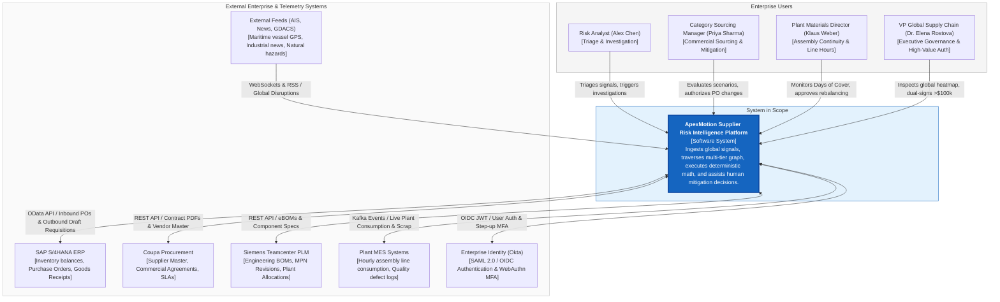
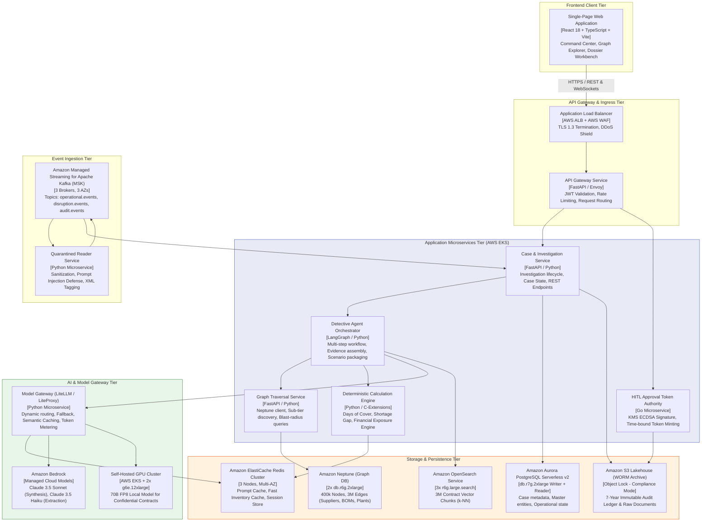
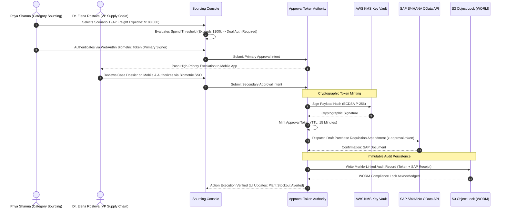

# HIGH-LEVEL DESIGN (HLD)
## ApexMotion Supplier Risk Intelligence Platform
**Document Version:** 1.0  
**Status:** Approved for Implementation  
**Author:** Lead Enterprise Solution Architect, Forward Deployment Engineering (FDE)  
**Standard Compliance:** AI Solution Architecture Masterclass (HLD Standard - Slide 7)  
**Upstream References:** BRD v1.0, PRD v1.0, FRD/SRS v1.0

---

## 1. Purpose, Scope, and Business Context

### 1.1 Purpose
This High-Level Design (HLD) defines the end-to-end technical system architecture for the **ApexMotion Supplier Risk Intelligence Platform**. It establishes the structural boundaries, container topologies, inter-service integration patterns, data storage architectures, and deployment models required to realize the business capabilities and functional specifications defined in the upstream BRD, PRD, and FRD documents.

### 1.2 Business Context & Strategic Goals
ApexMotion is a global Tier-1 electric vehicle (EV) automotive manufacturer operating assembly plants across **India (Bengaluru, Pune)**, **Germany (Munich)**, **Mexico**, **Vietnam**, and the **United States**. The company coordinates **4,500 active suppliers across 38 countries**, managing **65,000 active component SKUs**.

Having incurred **USD 18,000,000** in unrecovered disruption losses in the prior fiscal year due to late detection of supplier bottlenecks, ApexMotion requires an enterprise intelligence platform to achieve:
1. **Early Risk Horizon:** Proactive detection of supply disruptions **7 to 30 days** before manufacturing stockouts occur.
2. **Multi-Tier Visibility:** Deep dependency mapping from Tier-1 module suppliers down to Tier-2 micro-component makers and Tier-3 raw material refiners.
3. **Automated Rapid Investigation:** End-to-end incident investigation and dossier assembly in **under 90 seconds** (p95).
4. **Strict Separation of Responsibilities:** Absolute architectural isolation between **AI (unstructured evidence & narrative synthesis)**, **Deterministic Software (100% exact mathematical calculations)**, and **Human Authority (Human-in-the-Loop spend and action authorization)**.

```
┌────────────────────────────────────────────────────────────────────────────────────────┐
│                        ARCHITECTURAL PARADIGM: THE SEPARATION TRIAD                    │
├────────────────────────────┬─────────────────────────────┬─────────────────────────────┤
│   AI & MODEL SERVICES      │   DETERMINISTIC ENGINES     │   HUMAN AUTHORITY (HITL)    │
├────────────────────────────┼─────────────────────────────┼─────────────────────────────┤
│ • Ingests external news    │ • Days of Inventory Cover   │ • Case Dossier Review       │
│ • Sanitizes RSS/web text   │ • Daily Consumption Burn    │ • Consequential Sign-off    │
│ • Extracts contract terms  │ • Inbound Shortage Gap Math │ • Cryptographic Auth Tokens │
│ • Synthesizes narrative    │ • Plant Financial Exposure  │ • SAP Draft PO Commitment   │
│ • ZERO ARITHMETIC ALLOWED  │ • 100% Exact / Zero AI Math │ • Final Capital Approval    │
└────────────────────────────┴─────────────────────────────┴─────────────────────────────┘
```

### 1.3 Scope of the Architecture
* **In-Scope:** Event-driven streaming ingestion (Amazon MSK), Quarantined Reader sanitization, Amazon Neptune Knowledge Graph, Amazon OpenSearch vector retrieval, deterministic calculation microservices, Model Gateway with multi-model routing and prompt caching, Human-in-the-Loop token service, and Write-Once-Read-Many (WORM) audit archiving.
* **Out-of-Scope:** Autonomous monetary disbursements, direct factory floor PLC automation, and general enterprise non-supply-chain file search.

---

## 2. Architecture Drivers: Key FRs, NFRs, and Constraints

In accordance with Slide 8 of the AI Solution Architecture Masterclass (*Architecture Drivers for AI*), the architecture balances six competing quality attributes through explicit design trade-offs:

```
                      LATENCY ◄─────── TRADE-OFF ──────► COST
                   (Sub-90s SLA)                     (Token Budgets)
                          ▲                               ▲
                          │                               │
                          ▼                               ▼
                      ACCURACY ◄────── TRADE-OFF ──────► SAFETY
                  (100% Exact Math)               (Quarantined Reader)
                          ▲                               ▲
                          │                               │
                          ▼                               ▼
                    SCALABILITY ◄───── TRADE-OFF ──────► OBSERVABILITY
                  (1,285 ev/s peak)               (Full WORM Audit)
```

### 2.1 Critical Quality Attributes & Architecture Levers
| Driver Category | Target Production Metric | Architectural Solution Lever | Design Trade-Off Accepted |
| :--- | :--- | :--- | :--- |
| **Latency** | End-to-end incident investigation $\le 90$s (p95); graph traversal $\le 5$s. | Parallel async orchestration (LangGraph), prompt caching, model routing (Haiku for triage, Sonnet for synthesis). | Accepts higher orchestrator complexity to avoid sequential multi-hop latency bottlenecks. |
| **Accuracy** | 100% mathematical accuracy; zero hallucinations in calculations; $\ge 98\%$ groundedness. | **Strict Triad Separation:** All arithmetic executed by compiled Python microservices; model restricted to narrative presentation. | Sacrifices end-to-end generative flexibility in exchange for zero calculation error risk. |
| **Cost** | Operating budget $\le \$25,000$/month for 1.11M daily events and 40–80 investigations. | Model Gateway pattern: semantic caching, small fast models for extraction (80% of calls), large models for synthesis. | Extra engineering overhead to manage multi-model routing and caching infrastructure. |
| **Safety** | Zero prompt injection from untrusted feeds; 100% human gating on spend $> \$0$. | Dedicated Quarantined Reader; strict XML data encapsulation; cryptographic ECDSA approval tokens. | Slightly higher ingestion pipeline latency (+1.2s) due to pre-ingestion sanitization steps. |
| **Scalability** | 1.11M events/day normal load (~12.8 ev/s); peak burst 1,285 ev/s during crises. | Distributed Kafka partitioning (Amazon MSK 3 AZs); KEDA event-driven auto-scaling on worker pods. | Higher idle infrastructure base cost to maintain 3-broker multi-AZ Kafka headroom. |
| **Observability**| Complete reconstruction of every prompt, calculation, and approval for 7 years. | OpenTelemetry distributed tracing, Langfuse LLM telemetry, Amazon Aurora + S3 Object Lock (WORM). | Increased storage footprint for immutable compliance logs. |

### 2.2 System Constraints
1. **Network & VPC Isolation:** All proprietary component designs, master contracts, and ERP pricing must remain within ApexMotion’s dedicated AWS VPC. No unvetted public model APIs.
2. **High Availability:** 99.9% uptime SLO ($\le 8.76$ hours unscheduled downtime/year).
3. **Regulatory Data Sovereignty:** EU manufacturing data must reside in Frankfurt (`eu-central-1`); Indian data must reside in Mumbai (`ap-south-1`).

---

## 3. System Context (C1) and Container View (C2)

The system architecture is documented using the **C4 Model** (Context, Container, Component, Code) per Slide 9 of the Masterclass.

### 3.1 C1: System Context Diagram
The C1 diagram shows the ApexMotion Risk Intelligence Platform in its enterprise ecosystem, depicting the primary human actors and external systems.



---

### 3.2 C2: Container View Diagram
The C2 diagram zooms inside the system boundary, illustrating the major applications, microservices, databases, streaming buses, and AI infrastructure.



---

## 4. Key Flows as Sequence and Dynamic Diagrams

### 4.1 End-to-End Incident Investigation Flow (The NanoCore Fire Incident)
This sequence diagram details the runtime execution path for **Incident SR-2026-091**, demonstrating how the system completes the investigation within **82.4 seconds** while enforcing the Triad of Separation.

```mermaid
sequenceDiagram
    autonumber
    participant Feed as External News / RSS
    participant QR as Quarantined Reader
    participant MSK as Amazon MSK Bus
    participant Orch as Detective Agent (LangGraph)
    participant Graph as Amazon Neptune
    participant SAP as SAP S/4HANA Connector
    participant Math as Deterministic Math Engine
    participant ModelGW as Model Gateway
    participant LLM as Amazon Bedrock (Claude)
    participant Aurora as Aurora PostgreSQL
    participant UI as Risk Analyst Workbench

    Note over Feed,QR: 00.0s - 05.0s: Ingestion & Threat Sanitization
    Feed->>QR: Raw RSS Payload ("Cleanroom fire at NanoCore Semiconductor")
    QR->>QR: Strip scripts, check injection score (0.02), enclose in <untrusted_signal>
    QR->>MSK: Publish disruption.verified (SUP-NC-882, Conf: 94%)

    Note over MSK,Orch: 05.0s - 15.0s: Trigger & Orchestration Init
    MSK->>Orch: Consume Event & Initialize Investigation Workflow
    Orch->>Graph: Query Tier-2 to Plant Dependency Chain

    Note over Graph,SAP: 15.0s - 35.0s: Multi-Tier Blast-Radius Discovery
    Graph-->>Orch: Path: NanoCore -> MCU-X91 -> BetaElectro -> Battery ECU -> Munich, BLR, Pune
    Orch->>SAP: Fetch Inventory Balances & Inbound POs for MCU-X91
    SAP-->>Orch: Stock On-Hand = 142,000; Inbound PO #88921 = 80,000 (ETA 9.0d)

    Note over Orch,Math: 35.0s - 45.0s: STRICT DETERMINISTIC CALCULATION
    Orch->>Math: Execute Days of Cover & Shortage Gap
    Note over Math: Pure Python / C-Extension Math<br/>Cover = 142,000 / 18,500 = 7.7 Days<br/>Gap = 9.0 - 7.7 = 1.3 Days<br/>Shortage = 1.3 * 18,500 = 24,050 Units<br/>Line Downtime Exposure = $2,450,000
    Math-->>Orch: Exact Calculation Struct (Math Hash Verified)

    Note over Orch,LLM: 45.0s - 75.0s: Evidence Synthesis & Scenario Packaging
    Orch->>ModelGW: Synthesize Dossier Narrative + Mitigations (Structured Prompt)
    ModelGW->>LLM: Claude 3.5 Sonnet (Temp: 0.1, Grounded Prompts)
    LLM-->>ModelGW: JSON Dossier with Citations & 3 Ranked Scenarios
    ModelGW-->>Orch: Verified Narrative Payload

    Note over Orch,UI: 75.0s - 82.4s: Persist & Present
    Orch->>Aurora: Store Incident Case Record (Status: READY_FOR_REVIEW)
    Orch-->>UI: Push Complete Dossier via WebSocket (Total Latency: 82.4s)
    UI->>UI: Render Heatmap, Blast Radius, Math Breakdown, and Scenarios
```

---

### 4.2 Cryptographically Governed HITL Spend Approval Flow
This dynamic flow illustrates the step-by-step authorization and draft dispatch for emergency air freight conversion (\$180,000 spend).



---

## 5. Data Architecture and Integration Points

### 5.1 Polyglot Persistence Strategy
The platform avoids single-database bottlenecks by employing a polyglot persistence architecture aligned with specific query access patterns:

```
┌────────────────────────────────────────────────────────────────────────────────────────┐
│                        POLYGLOT DATA STORAGE ARCHITECTURE                              │
├────────────────────┬─────────────────────┬───────────────────┬─────────────────────────┤
│ DATABASE ENGINE    │ ROLE & WORKLOAD     │ ACCESS PATTERN    │ SIZING / CAPACITY       │
├────────────────────┼─────────────────────┼───────────────────┼─────────────────────────┤
│ Amazon Neptune     │ Multi-Tier Graph    │ OpenCypher Graph  │ 2x db.r6g.2xlarge       │
│                    │ (Tier-1/2/3, BOMs)  │ Traversals (p99<5s│ 400k Nodes, 3M Edges    │
├────────────────────┼─────────────────────┼───────────────────┼─────────────────────────┤
│ Amazon Aurora      │ Relational State    │ ACID Transactions │ Serverless v2           │
│ PostgreSQL v16     │ (Cases, Entities)   │ Relational Queries│ db.r7g.2xlarge          │
├────────────────────┼─────────────────────┼───────────────────┼─────────────────────────┤
│ Amazon OpenSearch  │ Vector Document RAG │ k-NN Vector Search│ 3x r6g.large.search     │
│ Service v2.11      │ (Contract Clauses)  │ Cosine Similarity │ 3M Chunks, 1536-dim     │
├────────────────────┼─────────────────────┼───────────────────┼─────────────────────────┤
│ Amazon ElastiCache │ Operational Caching │ In-Memory Key-Val │ 3 Nodes, Multi-AZ       │
│ Redis Cluster      │ (Prompts, Stock)    │ Sub-millisecond   │ 50 GB In-Memory         │
├────────────────────┼─────────────────────┼───────────────────┼─────────────────────────┤
│ Amazon S3 + Lock   │ WORM Audit Archive  │ Immutable Append  │ S3 Standard +           │
│ (Compliance Mode)  │ (Prompts, Hashes)   │ Write-Once-Read-7y│ Object Lock (WORM)      │
└────────────────────┴─────────────────────┴───────────────────┴─────────────────────────┘
```

### 5.2 Enterprise Integration Points & Data Contracts
1. **SAP S/4HANA (Inventory & Open POs):**
   * *Protocol:* OData v4 over HTTPS / mTLS client certificates.
   * *Contract:* `GET /A2X/sap/opu/odata4/sap/api_purchaseorder_2/`
   * *Sync Frequency:* Real-time event streaming for stock changes via SAP Event Mesh $\rightarrow$ Kafka bridge; polling fallback every 15 minutes.
2. **Coupa Procurement (Supplier Master & Contracts):**
   * *Protocol:* RESTful HTTPS / OAuth 2.0.
   * *Contract:* JSON payload synchronization for Approved Manufacturer Lists (AML) and PDF contract retrieval.
3. **Siemens Teamcenter (Engineering BOMs & MPNs):**
   * *Protocol:* REST / XML Webhooks.
   * *Contract:* Daily delta ingestion of engineering assembly changes; instant webhook notification upon component revision updates.
4. **Plant MES Systems (Bengaluru, Pune, Munich, Mexico, Vietnam, US):**
   * *Protocol:* High-throughput Kafka producer writing directly to AWS MSK topic `mes.production.consumption.v1`.

---

## 6. Deployment View and Environments

### 6.1 Network Zones & VPC Topology (Slide 20 Pattern)
In accordance with Slide 20 (*Traffic Flow and Network Zones*), the platform strictly isolates workloads across three secure network tiers:

```
┌────────────────────────────────────────────────────────────────────────────────────────┐
│                        AWS VPC TOPOLOGY (10.100.0.0/16)                                │
├────────────────────────────────────────────────────────────────────────────────────────┤
│ PUBLIC ZONE (DMZ SUBNETS: 10.100.1.0/24, 10.100.2.0/24)                                │
│ ┌────────────────────────────────────────────────────────────────────────────────────┐ │
│ │  AWS WAF (Rate Limiting, SQLi, GeoIP) ──► Application Load Balancer (ALB)          │ │
│ │  NAT Gateways (Egress Only for External Feeds)                                     │ │
│ └────────────────────────────────────────┬───────────────────────────────────────────┘ │
│                                          │ mTLS / Strict Port 443                      │
│                                          ▼                                             │
│ PRIVATE APPLICATION SUBNETS (10.100.10.0/24, 10.100.20.0/24)                          │
│ ┌────────────────────────────────────────────────────────────────────────────────────┐ │
│ │  AWS EKS Cluster (Kubernetes 1.30):                                                │ │
│ │  • API Gateway Pods (Envoy)          • Quarantined Reader Pods                     │ │
│ │  • Detective Agent Pods (LangGraph)  • Deterministic Math Engine Pods              │ │
│ │  • Model Gateway Pods (LiteLLM)      • Self-Hosted GPU Pods (vLLM on g6e.12xlarge) │ │
│ └────────────────────────────────────────┬───────────────────────────────────────────┘ │
│                                          │ Private Subnet Peering                      │
│                                          ▼                                             │
│ PRIVATE DATA SUBNETS (10.100.100.0/24, 10.100.200.0/24) - NO INTERNET EGRESS          │
│ ┌────────────────────────────────────────────────────────────────────────────────────┐ │
│ │  • Amazon MSK Kafka Cluster (3 AZs)    • Amazon Neptune Graph DB                   │ │
│ │  • Amazon Aurora PostgreSQL (Primary)  • Amazon OpenSearch Vector Cluster          │ │
│ │  • Redis ElastiCache Cluster           • S3 Gateway Endpoints (Zero Internet Egress│ │
│ └────────────────────────────────────────────────────────────────────────────────────┘ │
└────────────────────────────────────────────────────────────────────────────────────────┘
```

### 6.2 Environments Lifecycle Matrix
| Environment | Purpose | Infrastructure Topology | Data Profile |
| :--- | :--- | :--- | :--- |
| **Dev / Test** | Continuous integration, unit testing, automated PR checks. | Single AZ EKS, Aurora Serverless min capacity, mock Kafka. | Synthetic ERP data, anonymized contracts. |
| **Stage / Pre-Prod** | Performance benchmarking, chaos injection, regression evals. | Multi-AZ replica of production, Bedrock + mock SAP APIs. | Golden benchmark datasets (NanoCore simulation). |
| **Production** | Live 24/7 enterprise manufacturing risk intelligence. | Full Multi-AZ across 3 AZs, active-passive DR in secondary region. | Live enterprise data from all 5 manufacturing countries. |

---

## 7. Security, Availability, and Disaster-Recovery Approach

### 7.1 Security Architecture & AI Defense (Slide 22 Pattern)
The platform implements a multi-layered defense model specifically addressing AI-specific attack vectors:

```
┌────────────────────────────────────────────────────────────────────────────────────────┐
│                        AI THREAT DEFENSE MATRIX (SLIDE 22)                             │
├────────────────────┬─────────────────────────────────┬─────────────────────────────────┤
│ THREAT VECTOR      │ RISK PROFILE                    │ ARCHITECTURAL COUNTERMEASURE    │
├────────────────────┼─────────────────────────────────┼─────────────────────────────────┤
│ Prompt Injection   │ Malicious external news text    │ Quarantined Reader strips       │
│                    │ attempts to hijack agent prompt │ directives; encapsulates raw    │
│                    │ or reset supplier risk status.  │ text in passive XML boundaries. │
├────────────────────┼─────────────────────────────────┼─────────────────────────────────┤
│ Tool Poisoning /   │ Corrupted payload tricks model  │ Strict Pydantic schema validator│
│ Schema Hijacking   │ into unauthorized tool calls.   │ with parameter boundary typing; │
│                    │                                 │ least-privilege tool execution. │
├────────────────────┼─────────────────────────────────┼─────────────────────────────────┤
│ Data Exfiltration  │ Model output leaks confidential │ Output guardrail masks PII/costs│
│ & Cost Leakage     │ EV BOM design to public models. │ Private VPC Bedrock endpoints;  │
│                    │                                 │ zero data retention agreements. │
├────────────────────┼─────────────────────────────────┼─────────────────────────────────┤
│ Denial of Wallet   │ Infinite agent loops exhaust    │ Hard token cap (4,000 max out); │
│                    │ API budgets during crisis.      │ per-incident budget limit ($15);│
│                    │                                 │ rate limiter on Model Gateway.  │
├────────────────────┼─────────────────────────────────┼─────────────────────────────────┤
│ Rogue Execution    │ AI autonomously places orders or│ Cryptographic ECDSA token gated;│
│                    │ commits funds to suppliers.     │ Zero autonomous write APIs in   │
│                    │                                 │ enterprise transactional systems│
└────────────────────┴─────────────────────────────────┴─────────────────────────────────┘
```

### 7.2 High Availability & Disaster Recovery (HA/DR)
* **High Availability Design (99.9% SLO):** All services deploy across three Availability Zones (AZs) in AWS. Kubernetes pods utilize pod anti-affinity to prevent single-node failure outages.
* **Warm Standby Disaster Recovery:**
  * Primary Region: `eu-central-1` (Frankfurt) for European operations.
  * Secondary DR Region: `eu-west-1` (Ireland).
  * Aurora Global Database replication lag: $< 1.0$ second.
  * Cross-Region S3 Lakehouse Replication: Synchronous via S3 Multi-Region Access Points.
  * **Recovery Point Objective (RPO):** $\le 5$ minutes for regional data; **0 seconds** for WORM audit ledger.
  * **Recovery Time Objective (RTO):** $\le 4$ hours for complete regional DNS cutover via Amazon Route 53 health-check failover.

---

## 8. Technology Choices with Rationale (ADR Summary)

In accordance with Slide 5 and Slide 7 of the Masterclass (*Architecture Decision Records - ADRs*), the core technical choices are summarized below:

```
┌────────────────────────────────────────────────────────────────────────────────────────┐
│                        ARCHITECTURE DECISION RECORDS (ADRs)                            │
├─────────┬──────────────────────┬─────────────────────────┬─────────────────────────────┤
│ ADR ID  │ TECHNOLOGY SELECTED  │ ALTERNATIVE CONSIDERED  │ ARCHITECTURAL RATIONALE     │
├─────────┼──────────────────────┼─────────────────────────┼─────────────────────────────┤
│ ADR-001 │ Amazon Neptune       │ Neo4j Self-Hosted,      │ Fully managed AWS native DB,│
│         │ (Knowledge Graph)    │ ArangoDB                │ multi-AZ high availability, │
│         │                      │                         │ OpenCypher + Gremlin support│
├─────────┼──────────────────────┼─────────────────────────┼─────────────────────────────┤
│ ADR-002 │ Pure Python Math Svc │ LLM Code Interpreter,   │ Zero hallucination risk,    │
│         │ (Deterministic Eng)  │ Embedded Prompt Math    │ 100% reproducible formulas, │
│         │                      │                         │ sub-50ms execution speed    │
├─────────┼──────────────────────┼─────────────────────────┼─────────────────────────────┤
│ ADR-003 │ LangGraph            │ AutoGen, CrewAI,        │ Cyclic graph workflows, fine│
│         │ (Agent Orchestrator) │ Semantic Kernel         │ control over state transitions│
│         │                      │                         │ native human-in-the-loop    │
├─────────┼──────────────────────┼─────────────────────────┼─────────────────────────────┤
│ ADR-004 │ LiteLLM Model GW     │ Direct SDK Calls,       │ Unified API, semantic cache,│
│         │ (Model Gateway)      │ Portkey, Langfuse Proxy │ automated fallback routing, │
│         │                      │                         │ dynamic rate/cost budgeting │
├─────────┼──────────────────────┼─────────────────────────┼─────────────────────────────┤
│ ADR-005 │ Amazon MSK (Kafka)   │ RabbitMQ, AWS SQS,      │ High throughput (1,285 ev/s)│
│         │ (Event Streaming)    │ Google Pub/Sub          │ partitioned ordering, Avro  │
│         │                      │                         │ schema registry, replayable │
├─────────┼──────────────────────┼─────────────────────────┼─────────────────────────────┤
│ ADR-006 │ S3 Object Lock (WORM)│ Database Soft-Deletes,  │ Cryptographically enforced  │
│         │ (Compliance Archive) │ Blockchain Hyperledger  │ compliance mode, ISO/TS     │
│         │                      │                         │ automotive audit adherence  │
└─────────┴──────────────────────┴─────────────────────────┴─────────────────────────────┘
```

---

## 9. Risks, Assumptions, and Open Technical Issues

### 9.1 Technical Risks & Mitigations
| Risk ID | Technical Risk Description | Severity | Architecture Mitigation |
| :--- | :--- | :--- | :--- |
| **TR-01** | Neptune Graph Query Latency Spikes during deep multi-tier traversal ($> 5$ hops). | **High** | Bound traversal depth to 3 hops in real-time query; maintain pre-computed neighborhood reachability indices in Redis. |
| **TR-02** | External LLM Provider Rate Limits or Outages during global supply chain crises. | **High** | Dual-provider Model Gateway: primary route to Amazon Bedrock (Claude 3.5 Sonnet), secondary fallback to self-hosted vLLM GPU cluster or Claude 3.5 Haiku. |
| **TR-03** | Ingestion Backpressure during burst disruption events (1,285 events/sec). | **Medium** | KEDA event-driven autoscalers configured to scale worker pods from 4 up to 32 based on consumer group lag. |

### 9.2 Architecture Assumptions
1. **SAP OData Bandwidth:** ApexMotion corporate network allows up to 100 requests/sec against the SAP S/4HANA OData gateway during crisis investigation windows.
2. **Contract Text Quality:** Digital supplier contracts provided in PDF format possess sufficient OCR resolution ($\ge 300$ DPI) for high-accuracy text extraction.

### 9.3 Open Technical Issues
* **ISSUE-01: Cross-Region Multi-Master Graph Synchronization:** Evaluating whether Amazon Neptune Global Databases should be provisioned across Frankfurt and Mumbai or if read-replicas with centralized write-master in Frankfurt are sufficient for Year 1 latency requirements.
* **ISSUE-02: Local Model Quantization Calibration:** Testing whether 70B FP8 local weights on `g6e.12xlarge` instances maintain $\ge 98\%$ clause extraction fidelity compared to full FP16 precision.

---
*End of Document — ApexMotion Supplier Risk Intelligence Platform HLD v1.0*
