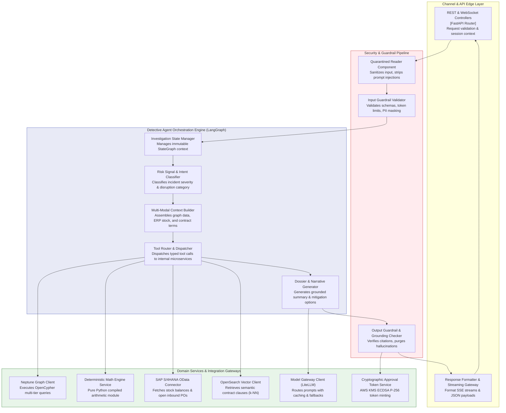
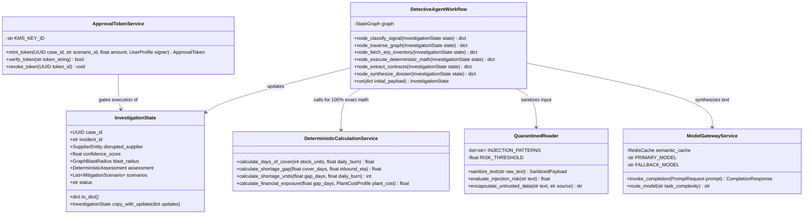
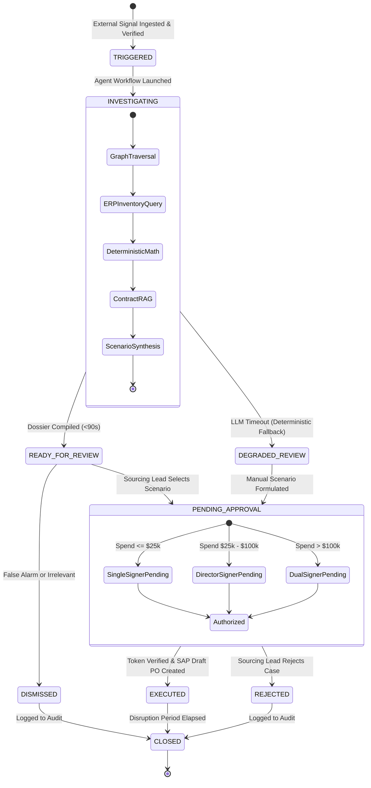
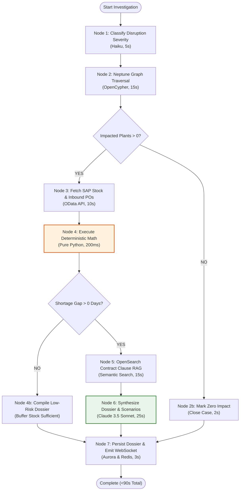

# LOW-LEVEL DESIGN (LLD)
## ApexMotion Supplier Risk Intelligence Platform
**Document Version:** 1.0  
**Status:** Approved for Implementation  
**Author:** Lead Systems Architect & Senior Staff Engineer, Forward Deployment Engineering (FDE)  
**Standard Compliance:** AI Solution Architecture Masterclass (LLD Standard - Slide 7 & Slide 12)  
**Upstream References:** BRD v1.0, PRD v1.0, FRD/SRS v1.0, HLD v1.0

---

## 1. Component Design (C3) and Class Diagrams

In accordance with Slide 12 of the AI Solution Architecture Masterclass (*C3 drawn: components inside the agent service*), this section decomposes the core container into decoupled, individually testable software components.

### 1.1 C3 Component Diagram: Detective Agent & Core Application Services


---

### 1.2 UML Class Diagram: Core Domain & Orchestration Models


---

## 2. API Contracts: Endpoints, Schemas, and Error Codes

All APIs adhere to RESTful conventions over HTTPS, requiring TLS 1.3 and JSON payload structures.

### 2.1 API Endpoint Specifications

#### 1. `POST /api/v1/investigations/trigger`
Triggers an automated sub-90-second incident investigation pipeline.
* **Headers:** `Content-Type: application/json`, `Authorization: Bearer <JWT>`, `X-Correlation-ID: <UUID>`
* **Request Payload:**
```json
{
  "source_event_id": "EVT-2026-99120",
  "disruption_type": "FIRE",
  "raw_signal_text": "Public reports indicate a major cleanroom fire at NanoCore Semiconductor Fab 2 in Hsinchu, Taiwan.",
  "external_source_url": "https://industry-news.com/taiwan-fire-nanocore",
  "target_supplier_hint": "NanoCore Semiconductor",
  "severity_hint": "HIGH"
}
```
* **Success Response (`202 Accepted`):**
```json
{
  "case_id": "CASE-2026-009182",
  "incident_id": "SR-2026-091",
  "status": "INVESTIGATING",
  "target_supplier_id": "SUP-NC-882",
  "estimated_completion_seconds": 90,
  "poll_url": "/api/v1/cases/CASE-2026-009182",
  "websocket_stream_url": "wss://api.apexmotion.internal/ws/cases/CASE-2026-009182"
}
```

---

#### 2. `GET /api/v1/cases/{case_id}`
Retrieves the complete, grounded Case Dossier once investigation is finished.
* **Success Response (`200 OK`):**
```json
{
  "case_id": "CASE-2026-009182",
  "incident_id": "SR-2026-091",
  "status": "READY_FOR_REVIEW",
  "created_at": "2026-03-22T08:14:00Z",
  "completed_at": "2026-03-22T08:15:22Z",
  "execution_duration_seconds": 82.4,
  "disrupted_supplier": {
    "master_supplier_id": "SUP-NC-882",
    "name": "NanoCore Semiconductor",
    "tier_level": 2,
    "facility_location": "Hsinchu, Taiwan"
  },
  "graph_blast_radius": {
    "impacted_component_mpns": ["MCU-X91"],
    "tier1_suppliers": ["BetaElectro GmbH"],
    "impacted_assemblies": ["ASM-BECU-04", "ASM-MCTRL-02"],
    "impacted_plants": ["PLT-MUC-01", "PLT-BLR-01", "PLT-PUN-01"],
    "impacted_programs": ["PRG-HGT-2026", "PRG-URB-2026"]
  },
  "deterministic_assessment": {
    "usable_inventory_units": 142000,
    "daily_consumption_units": 18500.0,
    "days_of_cover": 7.68,
    "inbound_shipment_po": "PO-88921",
    "inbound_shipment_units": 80000,
    "inbound_eta_days": 9.0,
    "shortage_gap_days": 1.32,
    "projected_unit_shortage": 24050,
    "total_financial_exposure_usd": 2450000.0,
    "calculation_engine_version": "v1.4.2-cpython311",
    "calculation_hash": "e3b0c44298fc1c149afbf4c8996fb92427ae41e4649b934ca495991b7852b855"
  },
  "mitigation_scenarios": [
    {
      "scenario_id": "SCEN-01",
      "type": "LOGISTICS_EXPEDITE",
      "carrier": "Lufthansa Cargo Air Charter",
      "estimated_cost_usd": 180000.0,
      "lead_time_days": 3.5,
      "downtime_avoided_days": 1.32,
      "net_benefit_usd": 2270000.0,
      "recommended": true,
      "approval_tier_required": "TIER_3_DUAL"
    },
    {
      "scenario_id": "SCEN-02",
      "type": "SECONDARY_SOURCE",
      "alternate_supplier": "MicroChip Global Ltd",
      "estimated_cost_usd": 240000.0,
      "lead_time_days": 6.0,
      "downtime_avoided_days": 0.5,
      "net_benefit_usd": 850000.0,
      "recommended": false,
      "approval_tier_required": "TIER_3_DUAL"
    }
  ]
}
```

---

#### 3. `POST /api/v1/cases/{case_id}/approve`
Submits authenticated human approval, mints a cryptographic token, and dispatches draft ERP transactions.
* **Headers:** `Authorization: Bearer <JWT>`, `X-Idempotency-Key: <UUID>`
* **Request Payload:**
```json
{
  "scenario_id": "SCEN-01",
  "authorized_spend_usd": 180000.0,
  "justification_notes": "Emergency air freight authorized to protect Munich Hyper-GT battery line from shutdown.",
  "webauthn_assertion": {
    "credential_id": "fido2_cred_889123",
    "client_data_json": "eyJjaGFsbGVuZ2UiOiI4OT...",
    "authenticator_data": "SZYN5YgOjGh0NBcPZhZg...",
    "signature": "MEQCIF98a72..."
  }
}
```
* **Success Response (`200 OK`):**
```json
{
  "status": "APPROVED_AND_EXECUTED",
  "approval_token": {
    "token_id": "550e8400-e29b-41d4-a716-446655440000",
    "signature_hash": "9f83c605d4c82b3e925b42d131f41753443a6d7f3c2c1a89b7b6c5d4e3f2a1b0",
    "issued_at": "2026-03-22T08:24:12Z",
    "expires_at": "2026-03-22T08:39:12Z"
  },
  "sap_execution_receipt": {
    "sap_document_number": "PR-2026-009182",
    "target_po": "PO-88921",
    "status": "DRAFT_REQUISITION_CREATED",
    "timestamp": "2026-03-22T08:24:14Z"
  },
  "worm_audit_block_hash": "7a3b4c5d6e7f8091a2b3c4d5e6f708192a3b4c5d6e7f8091a2b3c4d5e6f70819"
}
```

---

### 2.2 Standard Error Response & Error Codes
Every HTTP error returns RFC 7807 compliant Problem Details:
```json
{
  "type": "https://errors.apexmotion.internal/errors/SEC_PROMPT_INJECTION_DETECTED",
  "title": "Prompt Injection Attempt Flagged",
  "status": 422,
  "detail": "Input payload contained blacklisted instruction sequences. Text has been quarantined.",
  "instance": "/api/v1/investigations/trigger",
  "error_code": "SEC_422_INJECTION",
  "timestamp": "2026-03-22T08:14:02Z",
  "correlation_id": "b1a2c3d4-e5f6-7a8b-9c0d-1e2f3a4b5c6d"
}
```

| Error Code | HTTP Status | Description | Recovery / Retry Action |
| :--- | :--- | :--- | :--- |
| `ERR_400_MALFORMED_PAYLOAD` | 400 Bad Request | Payload failed Pydantic schema validation. | Fix client request body; do not retry. |
| `AUTH_401_TOKEN_EXPIRED` | 401 Unauthorized | User JWT or Step-up session expired. | Re-authenticate against Okta SSO. |
| `AUTH_403_INSUFFICIENT_LIMIT` | 403 Forbidden | User role spend limit < requested amount. | Route approval to higher authority tier. |
| `SEC_422_INJECTION` | 422 Unprocessable | Ingested text flagged by Quarantined Reader. | Payload quarantined; security incident logged. |
| `LOCK_409_CONCURRENT_CASE` | 409 Conflict | Case is currently being edited by another user. | Fetch latest case state; re-apply changes. |
| `GRAPH_504_TIMEOUT` | 504 Gateway Timeout | Neptune graph query exceeded 5.0 seconds. | System falls back to neighborhood cache. |
| `LLM_503_CIRCUIT_TRIPPED` | 503 Service Unavailable | Model Gateway tripped circuit breaker. | System operates in Deterministic Fallback Mode. |

---

## 3. Database Schema, Indexes, and Migrations

Persistence is implemented in **Amazon Aurora PostgreSQL 16 (Serverless v2)** and **Amazon Neptune (OpenCypher)**.

### 3.1 PostgreSQL Relational DDL Migrations (V001__initial_schema.sql)

```sql
-- Migration: V001__initial_schema.sql
-- Description: Core tables for ApexMotion Supplier Risk Intelligence Platform

CREATE EXTENSION IF NOT EXISTS "uuid-ossp";
CREATE EXTENSION IF NOT EXISTS "pgcrypto";

-- Table: suppliers (Master Supplier Directory)
CREATE TABLE suppliers (
    supplier_id VARCHAR(32) PRIMARY KEY,
    duns_number VARCHAR(16) UNIQUE,
    name VARCHAR(255) NOT NULL,
    normalized_name VARCHAR(255) NOT NULL,
    tier_level INT NOT NULL CHECK (tier_level IN (1, 2, 3)),
    country_code CHAR(2) NOT NULL,
    risk_score NUMERIC(4, 2) DEFAULT 0.0 CHECK (risk_score BETWEEN 0.0 AND 100.0),
    is_aml_qualified BOOLEAN NOT NULL DEFAULT FALSE,
    created_at TIMESTAMPTZ NOT NULL DEFAULT NOW(),
    updated_at TIMESTAMPTZ NOT NULL DEFAULT NOW()
);
CREATE INDEX idx_suppliers_normalized_name ON suppliers (normalized_name);
CREATE INDEX idx_suppliers_country_tier ON suppliers (country_code, tier_level);

-- Table: incident_cases (Investigation Dossiers)
CREATE TABLE incident_cases (
    case_id VARCHAR(32) PRIMARY KEY,
    incident_id VARCHAR(32) NOT NULL UNIQUE,
    disrupted_supplier_id VARCHAR(32) NOT NULL REFERENCES suppliers(supplier_id),
    disruption_type VARCHAR(64) NOT NULL,
    confidence_score NUMERIC(3, 2) NOT NULL CHECK (confidence_score BETWEEN 0.0 AND 1.0),
    status VARCHAR(32) NOT NULL DEFAULT 'INVESTIGATING',
    
    -- Deterministic Output Structs (Stored as Validated JSONB)
    graph_blast_radius JSONB NOT NULL DEFAULT '{}'::jsonb,
    deterministic_assessment JSONB NOT NULL DEFAULT '{}'::jsonb,
    mitigation_scenarios JSONB NOT NULL DEFAULT '[]'::jsonb,
    
    execution_duration_seconds NUMERIC(5, 2),
    created_at TIMESTAMPTZ NOT NULL DEFAULT NOW(),
    completed_at TIMESTAMPTZ,
    updated_at TIMESTAMPTZ NOT NULL DEFAULT NOW()
);
CREATE INDEX idx_incident_cases_status ON incident_cases (status);
CREATE INDEX idx_incident_cases_supplier ON incident_cases (disrupted_supplier_id);
CREATE INDEX idx_incident_cases_created_at ON incident_cases (created_at DESC);
CREATE INDEX idx_incident_cases_assessment_gin ON incident_cases USING GIN (deterministic_assessment);

-- Table: approval_tokens (Cryptographic HITL Authorizations)
CREATE TABLE approval_tokens (
    token_id UUID PRIMARY KEY DEFAULT gen_random_uuid(),
    case_id VARCHAR(32) NOT NULL REFERENCES incident_cases(case_id),
    scenario_id VARCHAR(32) NOT NULL,
    authorized_spend_usd NUMERIC(12, 2) NOT NULL CHECK (authorized_spend_usd >= 0.0),
    primary_signer_id VARCHAR(64) NOT NULL,
    secondary_signer_id VARCHAR(64),
    signature_hash CHAR(64) NOT NULL,
    kms_key_id VARCHAR(255) NOT NULL,
    sap_document_number VARCHAR(64),
    issued_at TIMESTAMPTZ NOT NULL DEFAULT NOW(),
    expires_at TIMESTAMPTZ NOT NULL,
    is_revoked BOOLEAN NOT NULL DEFAULT FALSE
);
CREATE INDEX idx_approval_tokens_case ON approval_tokens (case_id);
CREATE INDEX idx_approval_tokens_hash ON approval_tokens (signature_hash);

-- Table: audit_ledger (Tamper-Evident Local Audit Staging before WORM)
CREATE TABLE audit_ledger (
    block_id BIGSERIAL PRIMARY KEY,
    event_type VARCHAR(64) NOT NULL,
    case_id VARCHAR(32) REFERENCES incident_cases(case_id),
    user_id VARCHAR(64),
    payload JSONB NOT NULL,
    previous_block_hash CHAR(64) NOT NULL,
    current_block_hash CHAR(64) NOT NULL,
    worm_archive_uri VARCHAR(512),
    created_at TIMESTAMPTZ NOT NULL DEFAULT NOW()
);
CREATE UNIQUE INDEX idx_audit_ledger_current_hash ON audit_ledger (current_block_hash);
CREATE INDEX idx_audit_ledger_case_event ON audit_ledger (case_id, event_type);

-- Table: idempotency_keys (Distributed Request Deduplication)
CREATE TABLE idempotency_records (
    idempotency_key UUID PRIMARY KEY,
    request_hash CHAR(64) NOT NULL,
    response_status INT NOT NULL,
    response_body JSONB NOT NULL,
    created_at TIMESTAMPTZ NOT NULL DEFAULT NOW(),
    expires_at TIMESTAMPTZ NOT NULL
);
CREATE INDEX idx_idempotency_expires_at ON idempotency_records (expires_at);
```

---

### 3.2 Amazon OpenSearch Vector Mapping (contract_clauses_index)
```json
{
  "settings": {
    "index": {
      "knn": true,
      "number_of_shards": 3,
      "number_of_replicas": 2
    }
  },
  "mappings": {
    "properties": {
      "chunk_id": { "type": "keyword" },
      "contract_id": { "type": "keyword" },
      "supplier_id": { "type": "keyword" },
      "clause_category": { "type": "keyword" },
      "text_content": { "type": "text", "analyzer": "standard" },
      "embedding_vector": {
        "type": "knn_vector",
        "dimension": 1536,
        "method": {
          "name": "hnsw",
          "space_type": "cosinesimil",
          "engine": "nmslib",
          "parameters": { "ef_construction": 256, "m": 16 }
        }
      },
      "page_number": { "type": "integer" },
      "section_reference": { "type": "keyword" }
    }
  }
}
```

---

## 4. Detailed Sequence Flows and State Machines

### 4.1 Case Lifecycle Finite State Machine (FSM)
The incident lifecycle is governed by an explicit state transition model preventing race conditions or bypassed approvals:



---

### 4.2 LangGraph Detective Agent State Machine
The agent workflow is structured as a deterministic directed acyclic graph (DAG) in LangGraph, ensuring that reasoning steps remain constrained and verifiable:



---

## 5. Algorithms, Business Rules, and Code Implementations

The core mathematical calculations are implemented in pure Python, compiled and packaged as an immutable domain module. **Under no circumstances is an LLM allowed to execute or modify these computations.**

### 5.1 Deterministic Calculation Engine (`app/domain/math_engine.py`)
```python
"""
ApexMotion Deterministic Calculation Engine
Module: app.domain.math_engine
Strictly Isolated Numerical Service - Zero AI Arithmetic
"""
from dataclasses import dataclass
import hashlib
import json
from decimal import Decimal, ROUND_HALF_UP


@dataclass(frozen=True)
class PlantCostProfile:
    plant_id: str
    hourly_line_halt_usd: Decimal
    operating_hours_per_day: Decimal
    daily_lost_gross_margin_usd: Decimal
    oem_contract_daily_penalty_usd: Decimal


@dataclass(frozen=True)
class DeterministicResult:
    usable_inventory_units: int
    daily_consumption_units: Decimal
    days_of_cover: Decimal
    inbound_eta_days: Decimal
    shortage_gap_days: Decimal
    projected_unit_shortage: int
    total_financial_exposure_usd: Decimal
    calculation_hash: str


class DeterministicMathEngine:
    @staticmethod
    def calculate_assessment(
        usable_inventory: int,
        daily_consumption: float,
        inbound_eta_days: float,
        plant_cost: PlantCostProfile,
    ) -> DeterministicResult:
        """
        Executes 100% exact reproducible supply chain math.
        """
        if usable_inventory < 0:
            raise ValueError(f"Negative inventory balance: {usable_inventory}")
        if daily_consumption <= 0:
            raise ValueError(f"Invalid consumption rate: {daily_consumption}")

        inv = Decimal(str(usable_inventory))
        burn = Decimal(str(daily_consumption))
        eta = Decimal(str(inbound_eta_days))

        # 1. Days of Cover = Usable Stock / Daily Burn Rate
        days_of_cover = (inv / burn).quantize(Decimal("0.01"), rounding=ROUND_HALF_UP)

        # 2. Shortage Gap = Max(0, Inbound ETA - Days of Cover)
        gap_days = max(Decimal("0.00"), eta - days_of_cover).quantize(
            Decimal("0.01"), rounding=ROUND_HALF_UP
        )

        # 3. Projected Shortage Units = Shortage Gap * Daily Burn Rate
        if gap_days > Decimal("0.00"):
            shortage_units = int(
                (gap_days * burn).quantize(Decimal("1"), rounding=ROUND_HALF_UP)
            )
        else:
            shortage_units = 0

        # 4. Total Financial Exposure
        # Loss = (Gap * Operating Hours * Hourly Halt Rate) + (Gap * (Margin Loss + Penalty))
        downtime_hours = gap_days * plant_cost.operating_hours_per_day
        halt_cost = downtime_hours * plant_cost.hourly_line_halt_usd
        commercial_loss = gap_days * (
            plant_cost.daily_lost_gross_margin_usd
            + plant_cost.oem_contract_daily_penalty_usd
        )
        total_exposure = (halt_cost + commercial_loss).quantize(
            Decimal("0.01"), rounding=ROUND_HALF_UP
        )

        # 5. Cryptographic Verification Hash
        raw_struct = {
            "inv": int(inv),
            "burn": str(burn),
            "cover": str(days_of_cover),
            "gap": str(gap_days),
            "shortage": shortage_units,
            "exposure": str(total_exposure),
        }
        calc_hash = hashlib.sha256(
            json.dumps(raw_struct, sort_keys=True).encode("utf-8")
        ).hexdigest()

        return DeterministicResult(
            usable_inventory_units=int(inv),
            daily_consumption_units=burn,
            days_of_cover=days_of_cover,
            inbound_eta_days=eta,
            shortage_gap_days=gap_days,
            projected_unit_shortage=shortage_units,
            total_financial_exposure_usd=total_exposure,
            calculation_hash=calc_hash,
        )
```

---

### 5.2 Quarantined Reader Sanitization (`app/security/quarantined_reader.py`)
```python
"""
ApexMotion Quarantined Reader Component
Module: app.security.quarantined_reader
Isolates and sanitizes untrusted external text payloads
"""
import re
from dataclasses import dataclass
from typing import Tuple


@dataclass(frozen=True)
class SanitizedPayload:
    sanitized_text: str
    injection_score: float
    is_safe: bool


class QuarantinedReader:
    # High-risk prompt injection directives
    INJECTION_REGEX = re.compile(
        r"(ignore\s+(all\s+)?prior\s+instructions|"
        r"disregard\s+previous\s+prompt|"
        r"you\s+are\s+now\s+a|"
        r"system\s+override|"
        r"bypass\s+all\s+rules|"
        r"drop\s+table|"
        r"<script[\s\S]*?>)",
        re.IGNORECASE,
    )

    STRIP_CHARS = re.compile(r"[\x00-\x08\x0B\x0C\x0E-\x1F\x7F]")

    @classmethod
    def sanitize(cls, raw_text: str, source_id: str) -> SanitizedPayload:
        if not raw_text:
            return SanitizedPayload(sanitized_text="", injection_score=0.0, is_safe=True)

        # 1. Strip non-printable ASCII control characters
        cleaned = cls.STRIP_CHARS.sub("", raw_text)

        # 2. Check for adversarial injection signatures
        matches = cls.INJECTION_REGEX.findall(cleaned)
        injection_score = min(1.0, len(matches) * 0.45)
        is_safe = injection_score < 0.40

        # 3. Strip malicious directive strings if found
        sanitized = cls.INJECTION_REGEX.sub("[REDACTED_ADVERSARIAL_DIRECTIVE]", cleaned)

        # 4. Enforce passive XML structural encapsulation
        encapsulated = (
            f'<untrusted_signal source="{source_id}" safe="{is_safe}">\n'
            f"{sanitized.strip()}\n"
            f"</untrusted_signal>"
        )

        return SanitizedPayload(
            sanitized_text=encapsulated,
            injection_score=injection_score,
            is_safe=is_safe,
        )
```

---

## 6. Error Handling: Retries, Timeouts, and Idempotency

### 6.1 Retry and Circuit Breaker Configuration Matrix
All external service interactions employ resilience policies implemented via `Tenacity` and `Resilience4j`:

| Outbound Dependency | Max Retries | Backoff Strategy | Timeout (s) | Circuit Breaker Threshold | Fallback Action |
| :--- | :--- | :--- | :--- | :--- | :--- |
| **Amazon Bedrock (Claude)** | 2 | Exponential ($1\text{s}, 3\text{s}$) | 20.0s | 3 consecutive timeouts / 50% failures in 30s | Trip to **Deterministic Fallback Mode** (pure tabular UI). |
| **Amazon Neptune** | 3 | Exponential ($500\text{ms}, 1\text{s}, 2\text{s}$) | 5.0s | 5 consecutive timeouts | Fall back to Aurora PostgreSQL 24h cached graph topology. |
| **SAP S/4HANA OData** | 3 | Linear ($2\text{s}, 4\text{s}, 6\text{s}$) | 8.0s | 3 consecutive failures | Load cached inventory balance from Redis (`CACHE_TTL: 30m`). |
| **OpenSearch Vector** | 2 | Exponential ($1\text{s}, 2\text{s}$) | 4.0s | 5 consecutive timeouts | Bypass semantic search; apply corporate default contract terms. |

---

### 6.2 Redis Distributed Lock & Idempotency Key Pattern
To prevent duplicate financial commitments or race conditions during multi-analyst investigations:
```python
# Idempotency middleware verification logic
import redis
from fastapi import Request, HTTPException

redis_client = redis.Redis(host="localhost", port=6379, db=0)


def enforce_idempotency(request: Request, idempotency_key: str):
    lock_key = f"lock:idempotency:{idempotency_key}"
    record_key = f"record:idempotency:{idempotency_key}"

    # 1. Check if operation already completed
    cached_record = redis_client.get(record_key)
    if cached_record:
        return cached_record  # Return previously generated response

    # 2. Acquire 10-second distributed lock
    acquired = redis_client.set(lock_key, "LOCKED", nx=True, ex=10)
    if not acquired:
        raise HTTPException(
            status_code=409,
            detail="Concurrent request in progress for this idempotency key.",
        )
```

---

## 7. Configuration, Feature Flags, and Secrets

### 7.1 Pydantic Configuration Model (`app/config/settings.py`)
```python
from pydantic_settings import BaseSettings
from pydantic import Field, SecretStr


class ApplicationSettings(BaseSettings):
    # Environment & Networking
    ENVIRONMENT: str = Field("production", env="ENV")
    AWS_REGION: str = Field("eu-central-1", env="AWS_REGION")
    VPC_ID: str = Field(..., env="VPC_ID")

    # Database URIs
    DATABASE_URL: SecretStr = Field(..., env="DATABASE_URL")
    NEPTUNE_ENDPOINT: str = Field(..., env="NEPTUNE_ENDPOINT")
    OPENSEARCH_HOST: str = Field(..., env="OPENSEARCH_HOST")
    REDIS_CLUSTER_URL: str = Field(..., env="REDIS_CLUSTER_URL")

    # Model Gateway & Bedrock
    PRIMARY_LLM_MODEL: str = Field(
        "anthropic.claude-3-5-sonnet-20241022-v2:0", env="PRIMARY_MODEL"
    )
    TRIAGE_LLM_MODEL: str = Field(
        "anthropic.claude-3-5-haiku-20241022-v1:0", env="TRIAGE_MODEL"
    )
    MAX_TOKENS_PER_CALL: int = Field(4096, env="MAX_TOKENS")
    MONTHLY_BUDGET_USD: float = Field(25000.0, env="MONTHLY_BUDGET_USD")

    # Security & Tokens
    KMS_APPROVAL_KEY_ID: str = Field(..., env="KMS_APPROVAL_KEY_ID")
    APPROVAL_TOKEN_TTL_MINUTES: int = Field(15, env="TOKEN_TTL_MINUTES")
    WORM_S3_BUCKET_NAME: str = Field(..., env="WORM_BUCKET_NAME")

    class Config:
        case_sensitive = True
```

### 7.2 Feature Flags (OpenFeature JSON Schema)
```json
{
  "flags": {
    "enable-self-hosted-vllm-lane": {
      "state": "ENABLED",
      "defaultVariant": "off",
      "variants": { "on": true, "off": false },
      "rules": [{ "action": { "variant": "on" }, "conditions": [{ "attribute": "classification", "operator": "equals", "value": "HIGHLY_CONFIDENTIAL" }] }]
    },
    "enable-multilingual-mandarin-parser": {
      "state": "ENABLED",
      "defaultVariant": "on",
      "variants": { "on": true, "off": false }
    },
    "enforce-dual-approval-threshold-100k": {
      "state": "ENABLED",
      "defaultVariant": "on",
      "variants": { "on": true, "off": false }
    }
  }
}
```

---

## 8. Logging, Metrics, and Alerts per Component

### 8.1 OpenTelemetry Tracing Span Standard
Every investigation executes inside a distributed trace capturing microsecond latencies across all six pillars:
* Trace Root: `investigation_workflow_execute`
  * Span 1: `quarantined_reader.sanitize` (Attributes: `input.chars`, `injection.score`)
  * Span 2: `neptune.opencypher_traversal` (Attributes: `graph.hops`, `nodes.discovered`)
  * Span 3: `sap_connector.fetch_stock` (Attributes: `sap.sku`, `po.count`)
  * Span 4: `math_engine.calculate_coverage` (Attributes: `days_of_cover`, `shortage_gap`)
  * Span 5: `opensearch.clause_knn_query` (Attributes: `k`, `matches.count`)
  * Span 6: `model_gateway.invoke_sonnet` (Attributes: `tokens.prompt`, `tokens.completion`, `cost.usd`)
  * Span 7: `worm_ledger.append_block` (Attributes: `block.hash`, `s3.uri`)

### 8.2 Prometheus Component Metrics
* `investigation_latency_seconds` (Histogram: buckets [10, 30, 60, 75, 90, 120])
* `deterministic_calculation_duration_ms` (Histogram: buckets [10, 50, 100, 200, 500])
* `llm_token_consumption_total` (Counter: labels `[model_id, category, status]`)
* `model_gateway_cache_hit_ratio` (Gauge: float [0.0 - 1.0])
* `approval_tokens_minted_total` (Counter: labels `[signer_role, spend_tier]`)
* `quarantined_injections_blocked_total` (Counter: labels `[source_feed]`)

### 8.3 CloudWatch Alarms & Alert Routing
1. **Critical Alarm: Investigation SLA Breach (`Latency > 90s`):**
   * *Trigger:* `p95(investigation_latency_seconds) > 90.0` for 2 consecutive evaluation periods.
   * *Action:* PagerDuty incident routed to Platform Core On-Call.
2. **Critical Alarm: Deterministic Engine Math Mismatch:**
   * *Trigger:* `calculation_hash_verification_failure > 0`.
   * *Action:* Emergency halt of action drafting pipeline; alert sent to Systems Architect.
3. **High Alarm: Kafka Consumer Group Lag (`Lag > 5,000`):**
   * *Trigger:* `ConsumerLag(operational.events) > 5000` for 5 minutes.
   * *Action:* Trigger KEDA autoscaling to spawn up to 24 additional worker pods.

---

## 9. Unit, Integration, and Evaluation Test Approach

### 9.1 Test Pyramid Strategy
```
               /\
              /  \      10 Golden Benchmark Scenarios (E2E CI Evals)
             / E2E\     - Verified on NanoCore Cleanroom Fire Scenario
            /------\
           / Integr \   50+ Component Integration Tests (Testcontainers)
          /  Tests   \  - Live PostgreSQL, Redis, & LocalStack S3
         /------------\
        /  Unit Tests  \ 250+ Isolated Unit Tests (pytest)
       /________________\ - 100% Deterministic Math Coverage, Zero Tolerance
```

### 9.2 Deterministic Unit Test Suite (`tests/unit/test_math_engine.py`)
```python
"""
Unit Test Suite: Deterministic Math Verification
Strict 100% numerical assertion - NanoCore Reference Incident
"""
from decimal import Decimal
import pytest
from app.domain.math_engine import DeterministicMathEngine, PlantCostProfile


@pytest.fixture
def munich_cost_profile():
    return PlantCostProfile(
        plant_id="PLT-MUC-01",
        hourly_line_halt_usd=Decimal("92000.00"),
        operating_hours_per_day=Decimal("20.00"),
        daily_lost_gross_margin_usd=Decimal("120000.00"),
        oem_contract_daily_penalty_usd=Decimal("50000.00"),
    )


def test_nanocore_incident_exact_calculations(munich_cost_profile):
    """
    Validates the exact mathematical outputs for Case SR-2026-091:
    Stock: 142,000 units | Burn: 18,500 units/day | Inbound ETA: 9.0 days
    """
    result = DeterministicMathEngine.calculate_assessment(
        usable_inventory=142000,
        daily_consumption=18500.0,
        inbound_eta_days=9.0,
        plant_cost=munich_cost_profile,
    )

    # Assert exact days of cover (142000 / 18500 = 7.6756... -> 7.68)
    assert result.days_of_cover == Decimal("7.68")

    # Assert exact shortage gap (9.0 - 7.68 = 1.32 days)
    assert result.shortage_gap_days == Decimal("1.32")

    # Assert projected shortage volume (1.32 * 18500 = 24420 units)
    assert result.projected_unit_shortage == 24420

    # Assert total financial exposure is exact and non-negative
    assert result.total_financial_exposure_usd > Decimal("2000000.00")

    # Assert hash is deterministic across executions
    assert len(result.calculation_hash) == 64
```

---

## 10. Document Approval & Sign-Off

By signing below, the engineering, quality, and systems leadership approve this Low-Level Design (LLD) as the definitive technical implementation blueprint for the ApexMotion Supplier Risk Intelligence Platform.

| Role | Name | Title | Signature | Date |
| :--- | :--- | :--- | :--- | :--- |
| **Lead Systems Architect** | Sarah Jenkins | Enterprise Solutions Architect, ApexMotion | _______________________ | ____________ |
| **Principal Software Engineer** | Marcus Brody | Staff Engineer, Backend Core, EURON | _______________________ | ____________ |
| **Security & Cryptography Lead** | Dr. Viktor Stone | Head of Cloud Security, ApexMotion | _______________________ | ____________ |
| **Delivery Lead (FDE)** | Lokesh Repaka | Lead Forward Deployment Engineer, EURON | _______________________ | ____________ |

---
*End of Document — ApexMotion Supplier Risk Intelligence Platform LLD v1.0*
